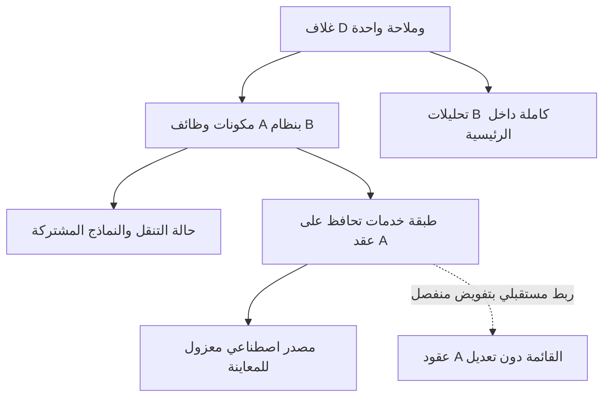

# UX-02 — تصحيح معماري: تطبيق واحد

الحالة: PROPOSED — AWAITING OWNER APPROVAL. لا تنفيذ ولا نشر في هذه الخطوة.

## النتيجة المثبتة

اعتراض المالك صحيح. D الحالية غلاف React من B يستضيف تطبيق A/C مستقلاً داخل iframe، ثم يضيف تحليلات B. إصلاح التحميل لا يجعلها تطبيقاً موحداً، وتغيير القائمة وحده لا يحل المشكلة.

الحالة المحفوظة: D الإصدار2، مصدر Sites 986968c27fe14a42ae3d2e945ebadb4ceffec11b، مصدر GitHub والأدلة283d369a8edcde3e97689c132b3739626261387e. تحقق بقاء الإصدارين1 و2 ومصادريهما البعيدة. لم تنشأ نسخة تشغيلية جديدة.

## مواضع الدمج الشكلي والفصل

|الموضع في المصدر|المثبت|الأثر|
|src/components/talabot/unified-review/index.tsx: OperationsFrame|iframe يحمّل public/operations-source/admin.html لكل قسم؛ postMessage ينقل الارتفاع والمظهر وحالة مختصرة|تطبيق داخل تطبيق؛ لا مكونات أعمال مشتركة|
|src/app/[locale]/(admin)/page.tsx|OperationsFrame ثم OperationsLinks ثم AnalyticsDashboard ثم SummaryCards وNeedsAttention|صف متتابع من واجهتين وعينتين، لا سياق موحد|
|src/app/[locale]/(admin)/operations/[section]/page.tsx|كل قسم يعيد المقدمة وشبكة12 رابطاً ثم iframe|لا صفحة React فعلية لوظيفة A|
|src/components/talabot/preview.tsx: PreviewSidebar/MobileNavigation|روابط A مضافة بجانب مداخل B، والملاحة الهاتفية لها منطق B|مسارات متنافسة للطلب والسائق والعميل والمنشأة|
|public/operations-source/admin.html|render/paint وقوالب HTML ونوافذ وحالة عامة ومعالجات inline|دورة عرض مستقلة عن React|
|public/operations-source/unified.css|إخفاء شريط A ولغته وخروجه بواسطة CSS وتغيير بعض السطوح|إخفاء الواجهة القديمة ليس دمجاً لوظائفها؛ البطاقات والأيقونات والنوافذ باقية منفصلة|
|boot.js وadapter.js مقابل workspace.tsx|تخزين A مسبوق باسم معاينة، OQ/OS وحالة tab، مقابل URL/sessionStorage في B|لا مصدر واحد لحالة البحث والرجوع؛ عيب إعادة نتائج البحث موثق|
|TLB.lang والقواميس مقابل next-intl؛ postMessage dark مقابل ThemeProvider|لغة ومظهر في نظامين، TG يعود إلى RU في A|نطاق ترجمة ومظهر غير موحد، Auto غير مثبت داخل الإطار|
|preview-client.js مقابل orders-data/directories-data/analytics-data|عينة A التشغيلية مستقلة عن أمثلة B وتحليلاته|هوية واحدة بصرياً لا تعني أن الكيانات والمقاييس تخص السجلات نفسها|
|adapter.js: ux-context|كتلة عامة تضاف بعد عرض التفاصيل|لا مكون سياق مهمة موحد ولا إجراء تالٍ مشتق من الإمكانات المثبتة|
|قائمة TailAdmin ونماذج operations-review|أمثلة قالب ظاهرة قرب الوظائف التشغيلية|خلط المثال مع الوظيفة؛ المصادر تُحفظ ولا تُرقّى إلى إنتاج|

### ما لم يُدمج فعلياً

جميع أقسام A الاثني عشر ما زالت داخل التطبيق المضمّن: الطلبات، المنشآت، السائقون، العملاء، الدعم، النصوص، التقييمات، البانرات، أكواد العروض، الولاء، السجل، الموظفون. يشمل ذلك البحث والرجوع والنماذج والتفاصيل والمحفظة والنقد والتسويات والصلاحيات والتدقيق. وجودها داخل iframe حفظٌ للمصدر ووصولٌ إليه، وليس نقلها إلى مكونات D.

الجرد الحالي:124 دالة مسماة،179 موضع معالج HTML،50 معرف حقل في manifest. هذه أعداد عناصر مصدر وليست عدد وظائف أعمال ولا إثبات شمول كل callback مجهول أو API. خريطة37 تغطي عائلات الأعمال، وجرد124 يحدد وجهة الدوال المسماة؛ معالجات179 والحقول50 مرجع مطابقة إلزامي قبل تنفيذ كل عائلة.

## البنية الهدف المقترحة

وثيقة واجهة واحدة: React root واحد، AdminShell واحد، سجل مسارات واحد، مكونات B الأساسية ونظام أيقونات واحد، طبقة حالة تنقل واحدة. لا iframe لتطبيق A، ولا حقن admin.html أو dangerouslySetInnerHTML كبديل مقنّع، ولا إعادة تشغيل render/paint القديم داخل React.

- طبقة الخدمات تفصل استدعاءات ونتائج A عن DOM: أسماء العمليات، المدخلات، شكل النتائج، الأخطاء، التأكيدات والقيود تبقى كما هي. تُستخرج الأجزاء المرتبطة بالعرض من TLB إلى خدمات قابلة للاستدعاء دون تغيير عقد الخادم. لا تحميل talabat-core كوسيلة لتشغيل التطبيق القديم بكامل واجهته.
- أول خطوة تنفيذ لاحقة: توصيف كل عملية مستخدمة وread/write والحقول/الأخطاء من المصدر. الأجزاء المجهولة تُسجل فجوة؛ لا نفترض أن TLB مكتبة مستقلة عن DOM أو أن المعاينة تثبت صلاحيات الخادم.
- وضع D يستعمل مصدر بيانات اصطناعياً فقط؛ الكتابات التشغيلية غير متصلة، والممنوع يبقى معلناً. ربط الإنتاج والمصادقة وأي ترحيل بيانات خارج هذه الخطة.
- حالة القوائم: route/entity/filter/query/page في سياق موحد، وحفظ موضع العودة بعد اكتمال تحميل النتائج. إعادة التحميل تعيد تنفيذ القراءة اللازمة، لا نص البحث فقط. المسودات منفصلة عن بيانات الخادم مع الحفاظ على تعارض السابق/الجديد وسلوك عدم تكرار الحفظ.
- هوية الكيانات موحدة داخل الرحلات التشغيلية؛ بيانات B التحليلية تبقى مجالاً اصطناعياً مستقلاً بمصدر وفترة معلنين. لا دمج حسابات A وB ولا ادعاء أن أرقام B تصف كيانات A.
- مكونات مشتركة: PageHeader، EntitySummary، StatusBadge، SearchFilters، DataTable، FormField، ActionButton، ConfirmationDialog، ConflictNotice، Loading/Empty/Error، Timeline، Conversation، MoneyBreakdown. الأسماء مقترحة؛ يعاد استخدام primitives الموجودة في B دون مكتبة أو لوحة ألوان جديدة.
- أيقونات المعاني المعتمدة مركزية؛ لمس44px واسم وصول ودلالة واضحة على الهاتف، دون الاعتماد على hover. التأكيد المالي لا يُختصر إلى أيقونة.
- LocaleTheme واحد؛ EN/RU/TG حسب النطاق المعتمد، والنقص ظاهر. Light/Dark/Auto من سياق واحد بما فيه modals والرسوم.

## الرئيسية وتفاصيل الطلب

أعلى المحتوى: أربع بطاقات A وتعريف النطاق الأصلي → الحالة والتنبيهات الأصلية → البحث والحالات والطلبات → كامل تحليلات B ومؤشرات B الأربع ضمن نطاقها. لا شبكة روابط أقسام داخل الرئيسية؛ التنقل داخل التحليلات روابط قفز لا صفحات بديلة ولا إخفاء مخطط.

حساب A: عدد آخر الطلبات المحملة حتى300 بجميع الحالات؛ الإيراد مجموع Total للمسلّم ضمنها؛ العمولة مجموع عمولته؛ النشط وفق حالات المصدر، لا إعادة تعريفه بعتبة جديدة. تُنقل الحسابات مع اختبارات مقارنة على نفس العينة، لا تُكتب من أسماء البطاقات.

OrderDetails: الحالة والرقم والرجوع؛ الأطراف بالترتيب منشأة/سائق/عميل؛ مراحل من الأحداث الفعلية؛ الإجراء الموجود المسموح أو سبب عدم توفره؛ الأصناف والمالية؛ Timeline والمحادثة. لا إضافة حالة أو مرحلة أو صلاحية. المحفظة بعد ملخص العميل، عائق استقبال السائق قبل النقد، وبحث المنشآت مع إبقاء الموافقات واضحة وفق C.

## التحليلات المحمية

AnalyticsDashboard وanalytics-data في B يحتفظان بمحتواهما وحساباتهما. AN00 أدوات الفترة؛ AN01 المكتملة والمبيعات؛ AN02 المالية والمصروفات؛ AN03 المناطق؛ AN04 تدفق الاستلام والتوصيل؛ AN05 أداء المنشآت؛ AN06 الأيام؛ AN07 الساعات؛ AN08 التغطية والإسناد والانتظار؛ AN09 الجودة والتأخير والإلغاء؛ AN10 الهدف الشهري. تبقى الرسوم الخمسة وأشرطة المناطق والجداول الأربعة وجدول الهدف والفلاتر والتوضيحات. [الجرد الأصلي الكامل](../analytics-inventory.md).

## النقل التدريجي المقترح وبوابات القبول

|المرحلة|النطاق|شرط إنهائها|
|0 — تجميد ومطابقة|نسخة D2 مرجع؛ جرد حقول/معالجات/عقود وتثبيت عينات مقارنة|مرجع بعيد ومصفوفة لا عناصر مفقودة أو بلا تصنيف|
|1 — أساس واحد|الغلاف والمكونات واللغة/المظهر وحالة التنقل وخدمات mock دون تشغيل DOM القديم|رحلة تجريبية رأسية أصلية في React بلا iframe، وفحص عدم وجود اتصالات تشغيلية|
|2 — الطلبات كاملة|مؤشرات A، البحث، الحالات، الصفحات، التفاصيل، الأطراف، الأصناف، المالية، Timeline والمحادثة، الرجوع والمسودات|مطابقة بيانات وحسابات A وتأكيداته؛ direct/reload/back؛ لا روابط تعيد إلى واجهة قديمة|
|3 — الأطراف|المنشآت والموافقات والتعرفة والملكية؛ السائق والنقد والحد والخريطة؛ العميل والمحفظة والتاريخ|كل حقول وإجراءات العائلة لها مكون وحالة واختبار؛ ترتيب C محفوظ|
|4 — بقية الإدارة|الدعم وقراراته؛ التقييمات؛ النصوص؛ البانرات؛ العروض والولاء؛ الموظفون؛ السجل|37 عائلة مغطاة، والعقود الحساسة مثبتة دون تغيير أو اتصال إنتاج|
|5 — التكامل الكامل|تحليلات B كاملة، إشعاراته وإعداداته، أمثلة القالب منفصلة|لا قائمة أو سجل كيانات تشغيلي ثانٍ، ولا تطبيق قديم مضمن|
|6 — QA وتسليم|320/390/1440؛ EN/RU/TG؛ Light/Dark/Auto؛ كل الرحلات والرسوم والحقول|أدلة فعلية ومطابقة الوظائف والحسابات؛ Safari الفعلي يظل NOT TESTED حتى يُنفذ؛ اعتماد مالك صريح|

كل مرحلة Commit مستقل مرفوع ومتحقق منه؛ لا حذف للأصل أو الأدلة. نسخة النقل التالية تكون في فرع معزول، ومراحلها لا تستضيف الشاشات غير المنقولة داخل iframe. تبقى الشاشات القديمة مرجع مقارنة مستقل خارج تطبيق المرشح، ولا تعلن نسخة جزئية لوحة مكتملة. إيقاف نشر مرحلة لا يلغي مصدرها؛ الرجوع إلى حفظ سابق بمسار عادي دون force push.

## مصفوفات التسليم والحكم

- [37 عائلة وظائف ومكوناتها المقترحة](function-matrix-37.md).
- [124 دالة مسماة ووجهة نقلها](named-functions-124.md)، ونسخة JSON مرافقة.
- [179 معالجاً و50 معرفاً للحفاظ والمطابقة](../original-manifest.json).
- الأسماء والمخطط خطة فقط. لا ننسب نجاح اختبارات الإصدار2 إلى المعمارية المقترحة.
- المطلوب اعتماد هذا النهج وحدود النقل وبواباته قبل أي تعديل تطبيقي. تفاصيل ترتيب الملاحة السابقة لم تُعتمد ولا تُعد أساساً نهائياً بمجرد ورودها في تقرير سابق.
- لا تغييرات تطبيقية في هذا التكليف، ولا نشر جديد، ولا تغيير A/B/C أو الإنتاج أو الألوان أو العقود أو الصلاحيات.
