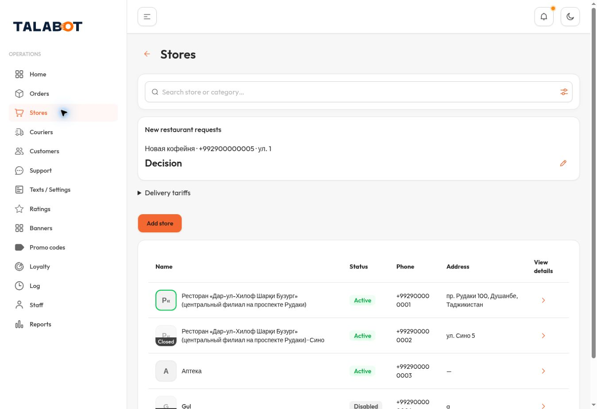
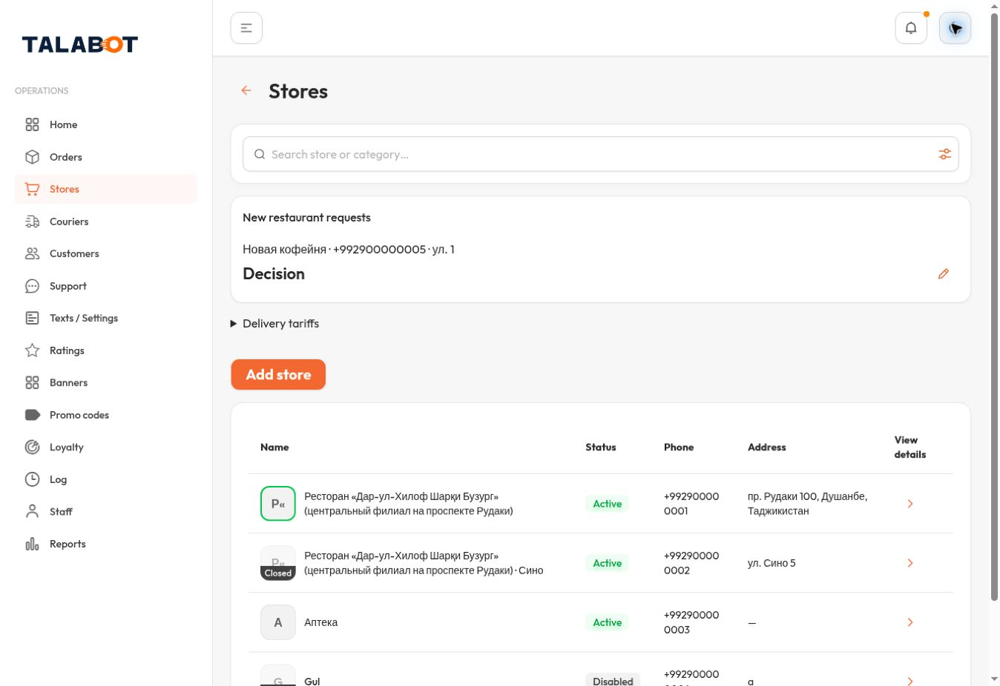
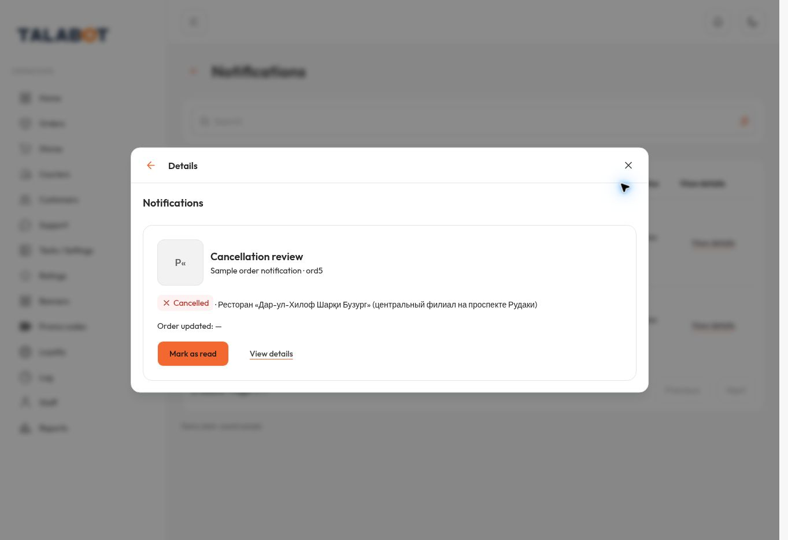
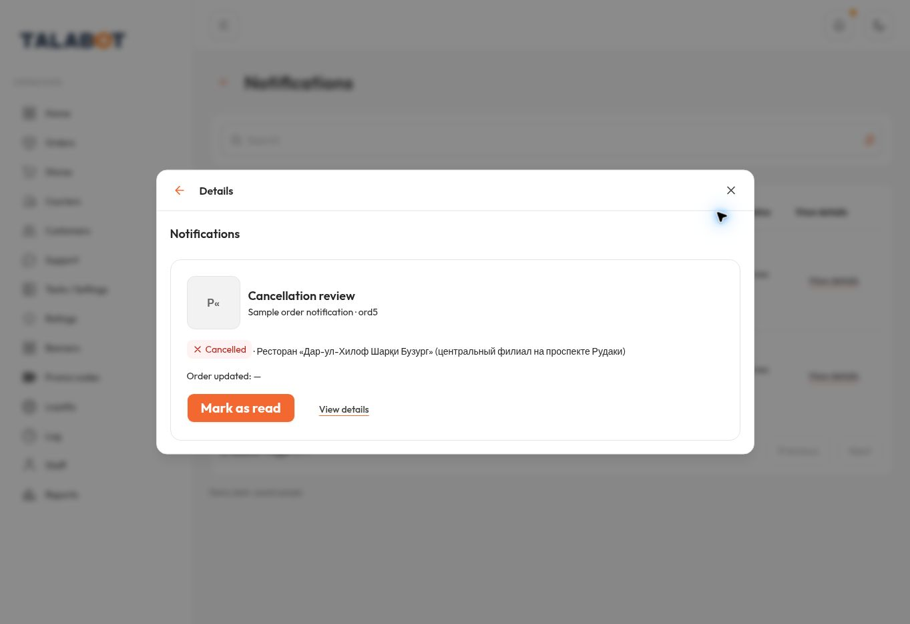
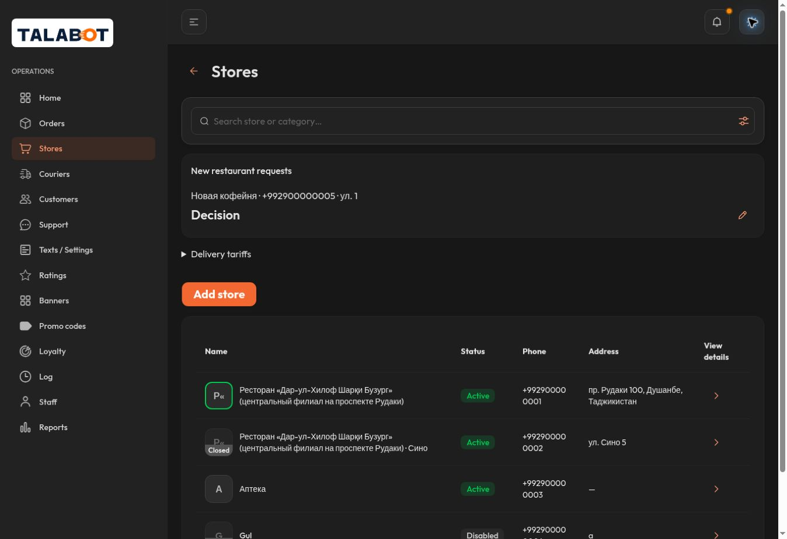
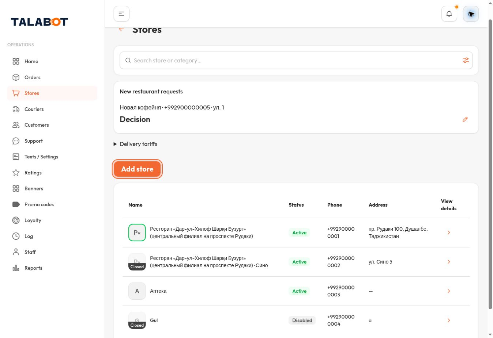
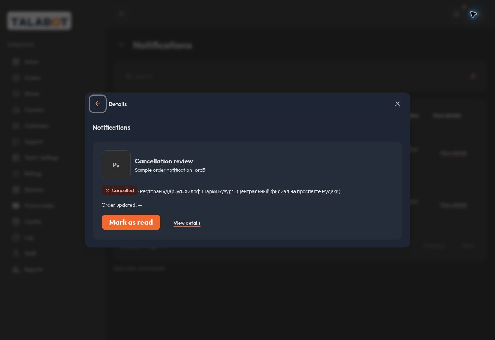
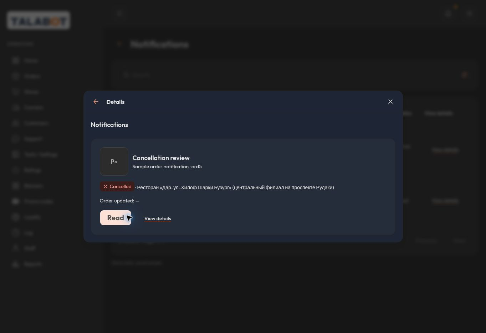

# مقارنة كتابة الزرين

قبل: `9fe131f8ef3e96204e8c693f3ea1d49af3e240fa`. بعد: `4a36654cb4b45a01fe28ad5b91aad9b95d4654ac`. EN / Chrome / viewport1363×936. تفاصيل المصدر والثيم والمقاس والبصمات في [metrics](evidence/metrics.json).

| الزر | قبل Light | بعد Light |
|---|---|---|
| إضافة متجر |  |  |
| تحديد كمقروء |  |  |

## Mark as read — light — focus

## Add store — dark — normal

## Add store — light — focus

## Mark as read — dark — normal

## Read — dark — disabled

