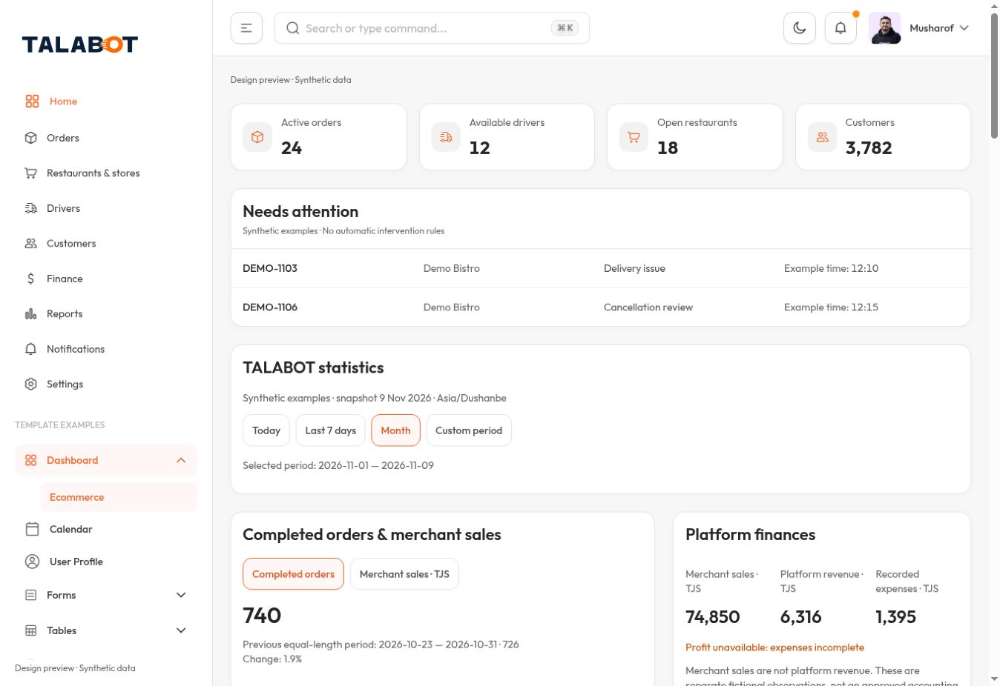
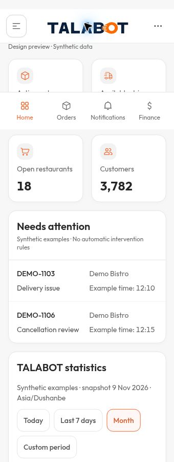
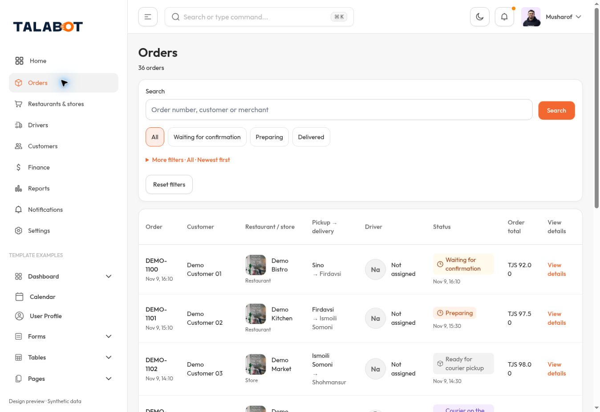
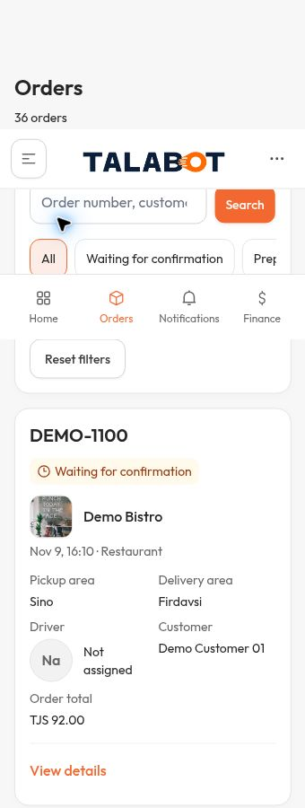
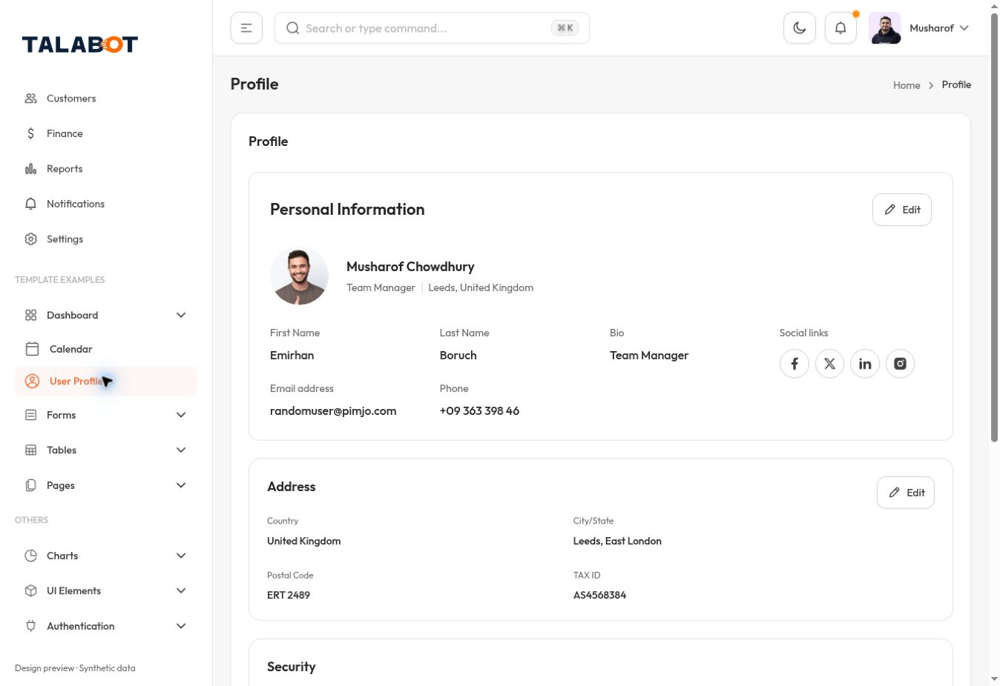
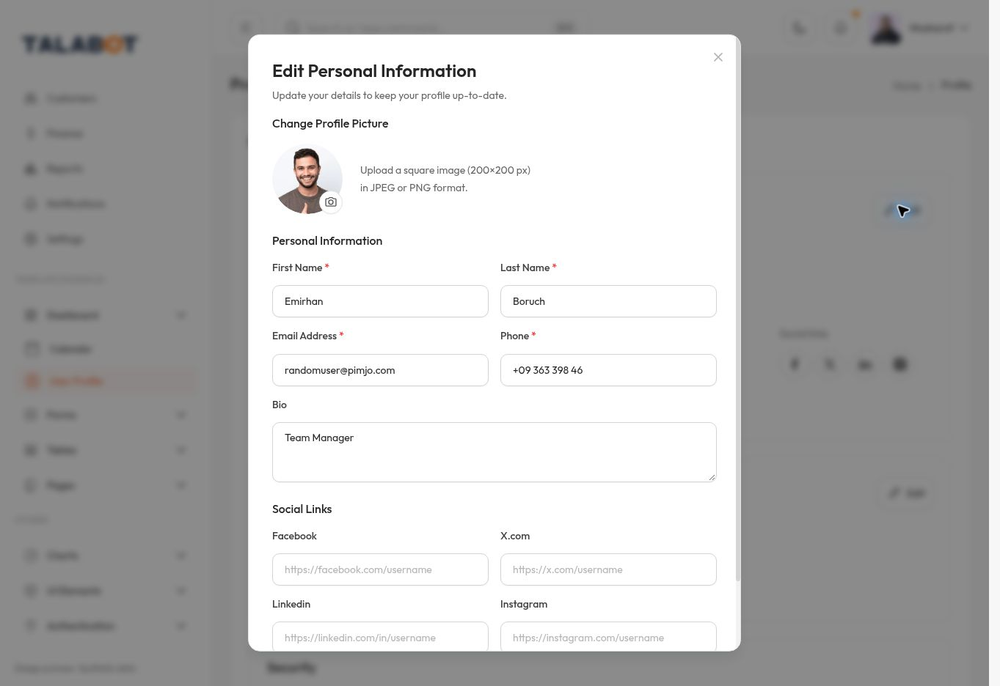

# UX-02 — Controlled composition review
الحالة: SOURCE REVIEW COMPLETE / VISUAL EVIDENCE PARTIAL / NO D CHANGES.
المرجع السابق e17f2feedf691a2a41068d252745ecb0f0b6c353؛ مصدر D المحمي 8dc1a27358f11a36efe6c23125f5ade72161dea8.
مرجع B المحلي 8dc0f4c30d1a390ec1c81c440b03f5ff9c549f87، ومعاينته الحية https://talabot-admin-d04-order-review.alwarikahtan.chatgpt.site/
مصادر B ذات الصلة محفوظة حرفياً داخل source-reference/ مع manifest لبصماتها، حتى لا تعتمد المراجعة على ملف محلي وحيد. الصور من B الحية، وليست ادعاء إثبات تطابق كل بايت من النشر مع Git.

## تصحيح حكم التقرير السابق
الحكم بأن SummaryCards لا توفر تركيباً أكثر كثافة كان ناقصاً: القراءة السابقة لم تجمع markup مع كامل polish.css.
- src/components/talabot/preview.tsx: SummaryCards يستخدم data-testid=summary-cards.
- src/components/talabot/integrated-review/polish.css: السطور84–106 تعيد تركيب البطاقة إلى عمود أيقونة40px وعمود عنوان/قيمة؛ تحت639px تصبح الأيقونة32px مع gap8. هذه CSS أصلية من B وليست CSS جديدة.
- السطور284–296 تجعل حقول orders-cards في شبكة عمودين، والسطور373–387 تجعل tp-quick شريطاً أفقياً عند الهاتف.
لذلك يلغى الاستنتاج السابق بعدم وجود نمط بصري مناسب للمؤشرات/كثافة بطاقات الطلبات. لا يلغى أي قرار مالك أو شرط حماية وظيفية. MetricCard في D لا يحمل hook SummaryCards، فلا يستفيد من قواعده.

## A — مؤشرات الرئيسية الأربع
| الخيار الفعلي | المسار الأصلي | الكمبيوتر | الهاتف وفق المصدر | أثر الوظيفة / الحكم |
|---|---|---|---|---|
| A1 MetricCard الحالي | src/components/main/dashboard/ecommerce/metrics/metric-card.tsx | بطاقة أيقونة أعلى، قيمة أسفل | عمودان لكن أيقونة48 وmt-5؛ نفس سبب الرفض | الحسابات محفوظة؛ غير موصى به للكثافة ولا يصغّر يدوياً |
| A2 SummaryCards مع polish الأصلي | src/components/talabot/preview.tsx + integrated-review/polish.css | أربع بطاقات؛ الأيقونة بجانب العنوان والقيمة | 2×2؛ أيقونة32، مسافات B الأصلية | أنسب تركيب بصري موجود؛ بيانات B الحالية24/12/18/3782 ليست مؤشرات A ولا تُنقل كحسابات |
| مستبعد: MonthlyStats | src/components/main/dashboard/ecommerce/monthly-target/monthly-stats.tsx | ثلاث قيم مع اتجاهات | صف يتطلب تغيير التركيب للأربع | ليس بديلاً مطابقاً؛ لا اختلاق اتجاه أو مقياس |

التوصية الوحيدة: A2، مع استبدال labels/values/icons ببيانات مؤشرات A من domain.metrics دون أي CSS جديد أو تغيير نطاق البيانات. تبقى مؤشرات B الأصلية داخل التحليلات ولا تستبدل بمؤشرات A.
قيد محدد قبل التنفيذ: SummaryCards أزرار تنقل إلى orders/drivers/restaurants/customers، بينما مؤشرات A المالية ليست هذه الوجهات. لا تُنسخ callbacks B ولا يُترك زر بلا وظيفة ولا يُختلق مسار تقرير. القبول المطلوب هو استخدام الشكل A2 مع تعريف السلوك: إن لم يوجد فعل أصلي لمؤشر A، يظل تكييف العنصر العرضي غير التفاعلي BLOCKED بانتظار اعتماد صريح لذلك التكييف. هذا ليس طلباً لإعادة اعتماد موضع المؤشرات أو حساباتها.

## B — صفوف الطلبات
| الخيار | مصدر B | الكمبيوتر | الهاتف | أثر الوظائف |
|---|---|---|---|---|
| B1 OrdersList | src/components/talabot/orders.tsx؛ orders-table / orders-cards + polish.css | 8 أعمدة عند xl | بطاقات، حقول dl في عمودين من polish | يحفظ سياق الطلب والحالة والصورة؛ البحث/الفلاتر منفصلة أعلى القائمة |
| B2 Grid العام | src/components/talabot/workspace.tsx؛ Grid | أعمدة ديناميكية | بطاقة هوية وقيم label/value | مناسب لقوائم الكيانات؛ أقل تخصصاً للطلبات وقد يتطلب تركيب حقول جديد |

التوصية الوحيدة: B1 للطلبات، وB2 للكيانات فقط. لا استخدام الجدول العام من عمودين لتجميع كل معلومات الطلب في خلية.

### خريطة الحقول المقترحة للموافقة
| حقول A | العرض المباشر المقترح | داخل التفاصيل بعد ضغط صريح | قيد الحماية |
|---|---|---|---|
| رقم الطلب، الحالة، الإنشاء | ID/status/date في مواضع OrdersList الأصلية | تبقى في رأس التفاصيل أيضاً | نص+رمز+لون؛ لا تحويل status enum |
| المنشأة ونوعها | هوية المنشأة كما في B؛ الصورة إن توفرت فقط | العنوان والتواصل والبيانات الموسعة | لا تركيب صورة مزعومة |
| العميل والسائق/غير مسند | خلايا/حقول B المقابلة مباشرة | الهاتف والملف والتواصل | لا استبدال الاسم ببيانات B |
| الاستلام والتوصيل | حقول B إذا توفرت قيم A | العنوان/الموقع المفصل | غياب zone لا يملأ بتخمين أو بمنطقة B |
| إجمالي الطلب | Total مباشرة | تفصيل الأصناف والمبالغ | لا استخدام قسمة B على100 على مبالغ A |
| الدفع، عدد الأصناف، رسوم التوصيل | تظل مباشرة لحين قرار؛ B1 لا يوفر لها خانات قائمة مطابقة حالياً | كلها موجودة في تفاصيل D؛ رسوم التوصيل لها amount-breakdown في B | نقلها من القائمة إلى التفاصيل غير منفذ. هذا تعارض توزيع محدد، وليس إذناً بإخفائها |
| كل صنف/كمية/خيارات/خصم | لا يضاف محتوى جديد للقائمة | تفاصيل الأصناف الأصلية عند الفتح | حفظ جميع الحقول |
| التحصيل والتسوية والعمولة | لا تُدمج بالإجمالي | الأقسام المالية الأصلية بمعانيها | لا نسخ حسابات B التجريبية |
| Timeline والمحادثة | لا تفتح تلقائياً | مغلقة افتراضياً وتفتح صراحة | خط الرحلة البرتقالي محفوظ |
| الإسناد/التنبيهات | تبقى نقاط الوصول الحالية حتى اعتماد الموضع المقابل | نافذة الإسناد الحالية وشروطها | لا تغيير الحالة أو السبب أو الصلاحية |

الأربع اختصارات + الفلتر الشامل مصرح بها الآن، فلا نعيد طلب اعتمادها: all/pending/preparing/delivered من B، مع جميع حالات A في الفلتر الشامل ونفس state/query/reset. لا نسخ بيانات فلاتر المناطق التجريبية إلى A.

## C — إجراءات الكيانات
| الخيار الموجود | المسار | الهاتف / الكمبيوتر | حد الاستخدام |
|---|---|---|---|
| C1 DirectoryPage / Grid | src/components/talabot/workspace.tsx | تفاصيل صريحة آخر البطاقة / آخر عمود الجدول؛ الهوية ثم الحقول | لا يحتوي توزيعاً جاهزاً للاتصال/الموقع/التعديل/النقد |
| C2 PersonalInformationSection + EditPersonalInfoDialog | src/components/main/profile/personal-information/index.tsx وedit-dialog/index.tsx | التعديل في رأس بطاقة المعلومات على الطرف المقابل للعنوان؛ نافذة لا تظهر حتى الضغط | النمط الأصلي زر Pencil+Edit؛ حقوله/schema تجريبية وليست عقد A |
| إجراء موصوف DangerItem | src/components/main/profile/danger/danger-item.tsx | الوصف ثم الزر على الهاتف؛ الوصف والزر في صف عند sm | مناسب مثالياً للإجراء الموصوف فقط؛ لا يعني أن التحصيل المالي إجراء أحمر أو أن Delete يساوي حظر العميل |
| Button/Dialog/أيقونات | src/components/ui/button.tsx وdialog.tsx؛ src/icons/index.tsx | مكونات أصلية متاحة | وجود primitive لا يثبت مكاناً تشغيلياً معتمداً |

التوصية الوحيدة: C2 للتعديل في رأس بطاقة المعلومات، مع فتح Dialog الأصلي صراحة والحفاظ على controller/validation/errors/draft keys وعقود A؛ لا نسخ schema ملف المستخدم أو قيمه التجريبية. لا تظهر بطاقة منفصلة فارغة للنموذج المغلق.
التحويل إلى أيقونة قلم فقط وفق القرار المثبت يستخدم Button icon-lg الموجود، لكن تغيير props في موضع C2 يُعرض هنا كتكييف للموافقة لا كنسخة حرفية من المثال.
الاتصال: CallIcon وButton موجودان؛ موضع مجاور للهاتف هو الاقتراح الوظيفي، لكنه ليس نمطاً جاهزاً مثبتاً في DirectoryPage المفحوصة، لذلك BLOCKED — placement approval.
الموقع: MapIcon وButton موجودان؛ موضع داخل مجموعة العنوان مقترح؛ لا نموذج خريطة تشغيلية مكافئ لـA مثبت، لذلك BLOCKED — placement / map behavior.
الإجراءات المالية الحساسة: لا مكان جاهز مطابق مثبت في B؛ تبقى في مواضع D المحفوظة، ولا تُحوّل إلى قائمة overflow أو DangerItem أو أيقونة غامضة. BLOCKED للتركيب الجديد فقط؛ لا حذف للوظيفة.
إبقاء روابط الشبكات الاجتماعية في صورة القالب لا يعني اقتراحها داخل TALABOT؛ هي جزء من المرجع المصوّر فقط.

## ما يمكن تصحيحه مباشرة ضمن التفويض الحالي
| المجموعة | ملفات D المستهدفة مستقبلاً | مصدر B / حدود التنفيذ |
|---|---|---|
| البحث + أربع اختصارات + فلتر شامل | native/index.tsx | OrdersList + tp-order-search/tp-quick/tp-secondary-filters حرفياً مع state A |
| Grid متجاوب | native/index.tsx وentity-sections.tsx | OrdersList للطلبات وGrid للكيانات؛ حقول بلا مقابل لا تعاد توزّع حتى القرار |
| الفراغ المحجوز | native/b-shell/admin-layout.tsx | إزالة حجز MobileNavigation الغائب، لا إضافة ملاحة ثانية أو تغيير safe-area بالافتراض |
| التواريخ | native/index/order-details/entity-sections/ticket-details | useFormat في orders.tsx؛ Intl/Asia-Dushanbe مع القيم الأصلية وفرزها |
| الحالات المثبتة | native/entity-sections.tsx | OrderStatusBadge للطلبات، Badge لحالات ثبت mapping الخاص بها فقط |
| اللغة والمظهر | native/index.tsx وb-shell/app-header.tsx وموضع الإعدادات | ThemeToggleButton في الرأس + SettingsPage EN/RU/TG وLight/Dark/Auto؛ لا إسقاط Auto ولا ادعاء اكتمال TG |
| النماذج المغلقة | native/native-form.tsx | لا بطاقة فارغة؛ تركيب C2 عند اعتماد تكييفه فقط، مع إبقاء المدخلات والمسودات عند الإغلاق |

هذه خريطة تنفيذ لا تنفيذ فعلي. لا حاجة لإعادة طرح أهداف الكثافة أو الأيقونات أو الألوان أو التحليلات أو موضع المؤشرات.

## الصور — قراءة مهمة قبل المقارنة
- صور الكمبيوتر من B الحية، ملف screenshot بعرض1348px تقريباً؛ عرض المتصفح1363px. الصورة edit-desktop بعرض1363.
- الصور الضيقة من Chromium عند تكبير400%: window.innerWidth=340، innerHeight=234، dpr=4. اللقطة الممتدة340×900 لا تحول ارتفاع234 إلى ارتفاع هاتف900. الشريط المثبت قد يغطي محتوى داخل اللقطة بسبب ذلك.
- هذه أدلة لاستجابة الأنماط فقط، وليست صور iPhone ولا قبول عرض الهاتف. مقارنة الهاتف ذات الأبعاد الطبيعية320/390 لم تكتمل.
- تشغيل Chromium آلي مستقل فشل قبل فتح الصفحة؛ DevTools المتصفح أظهر منعاً من سياسة المؤسسة. لم أتجاوز المنع. استُخدم تكبير المتصفح العادي للتوثيق المحدود ثم أعيد100%.
- لا نطلب اعتماداً بصرياً نهائياً استناداً إلى الصور الضيقة، ولا تعتبر مواقع الشريط المثبت فيها عيباً مثبتاً على iPhone.
- الصور تعرض قيم B الأصلية، لا مؤشرات A أو تطبيق خيارات على D. لم أغير بيانات B أو تصميمه.

| العنصر | الكمبيوتر | العرض الضيق التشخيصي فقط |
|---|---|---|
| A2 SummaryCards |  |  |
| B1 OrdersList |  |  |
| C2 موضع التعديل |  |  |
| نافذة C2 |  | لم تُثبت عند ارتفاع هاتف طبيعي |
صورة تفاصيل الطلب: [b-detail-desktop.jpg](images/b-detail-desktop.jpg).

## الاختبارات والوظائف
نُفذ فعلياً: عرض B، فتح قائمة الطلبات، فتح DEMO-1100 والرجوع، فتح User Profile ثم نافذة Edit وإغلاقها دون حفظ. لا تفعيل اتصال/موقع/حذف/مال أو تغيير صلاحيات.
هذه ليست اختبارات D ولا مطابقة الوظائف37. لا Build/TypeScript/Lint جديدة لأن التغيير توثيقي فقط.
[مصفوفة أثر الوظائف37](IMPACT-37.md) تحتفظ بكل معرف ووضعه السابق؛ لا ترقية تلقائية.
الحسابات والتحليلات وReact root والملاحة ومصدرA المعزول لم تتغير. لا أي مصدر إنتاجي أو اتصال بيانات حقيقية.

## القرار المحدد ونقطة الاستئناف
A: اعتماد شكل A2 الأصلي مع حسم العنصر غير التفاعلي للمؤشرات التي لا تملك نقراً أصلياً؛ لا روابط أو حسابات مختلقة.
B: اعتماد B1 وتحديد موضع الدفع/عدد الأصناف/رسوم التوصيل قبل نقلها من موضعها الحالي؛ التوصية إبقاؤها ظاهرة حتى يوجد اعتماد صريح لتوزيعها.
C: اعتماد تكييف C2 للتعديل؛ الاتصال والموقع والإجراءات المالية بلا موضع B مطابق تبقى BLOCKED ولا تطبق.
صور الهاتف الطبيعية هي فجوة أدلة مستقلة، لا تفويض تصميم جديد.
الاستئناف من مصدر D المحمي8dc1a273، مع هذا التقرير، في فرع تنفيذ معزول بعد اعتماد الخيارات المحددة. لا تعديلA/B/C/D2، لا نشر ولا دمجmain.
