# معاينة المالك — Q40 وتصحيحات UX-02

هذه صور المعاينة المحلية v3؛ لم يحدث نشر جديد. مصدر «بعد»: `f0d723a7e2e8e7e4be259d952b5e7e7782e54918`، و«قبل»: `f28c80e78698137831d149ef4977126d16314048` (تجربة اللون السابقة غير المعتمدة). جميع البيانات اصطناعية محفوظة، وقياس DOM هو1363×936. الحجم الفعلي لكل صورة مستقل في الجدول الأخير.

## Q40 — زر إضافة المتجر

| Light — قبل | Light — البديل |
|---|---|
| 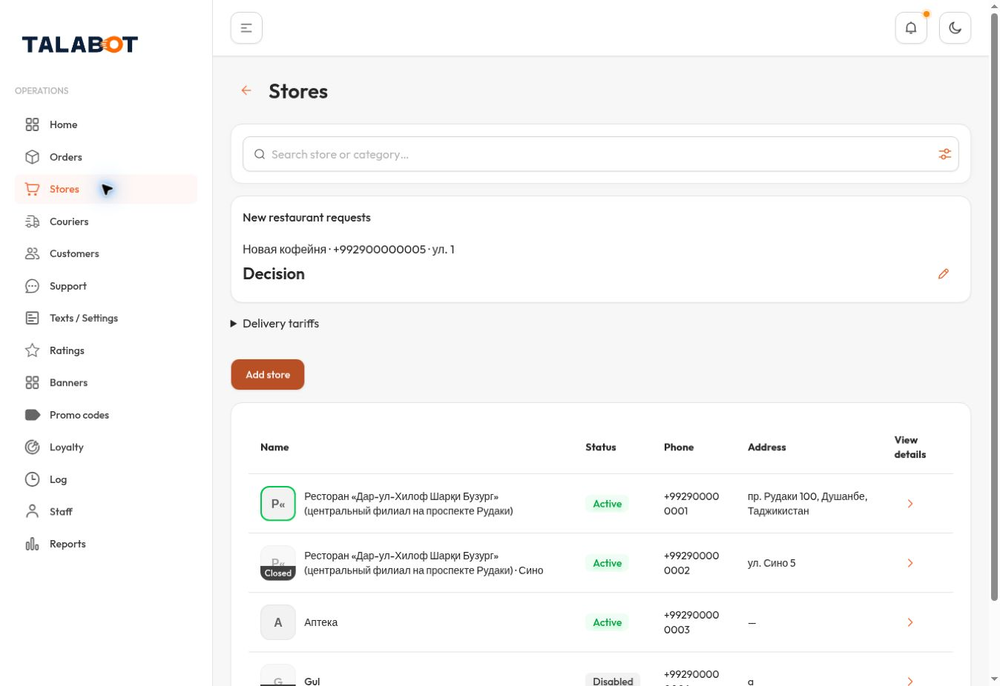 | 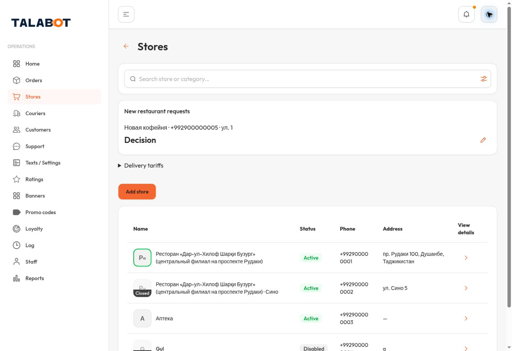 |

| Dark — قبل | Dark — البديل |
|---|---|
| 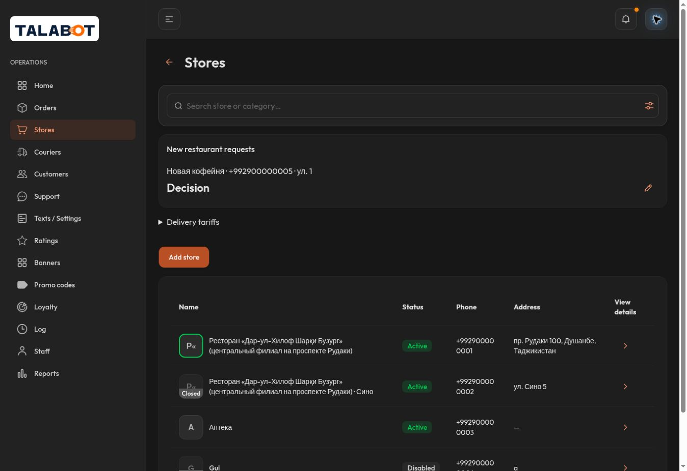 | 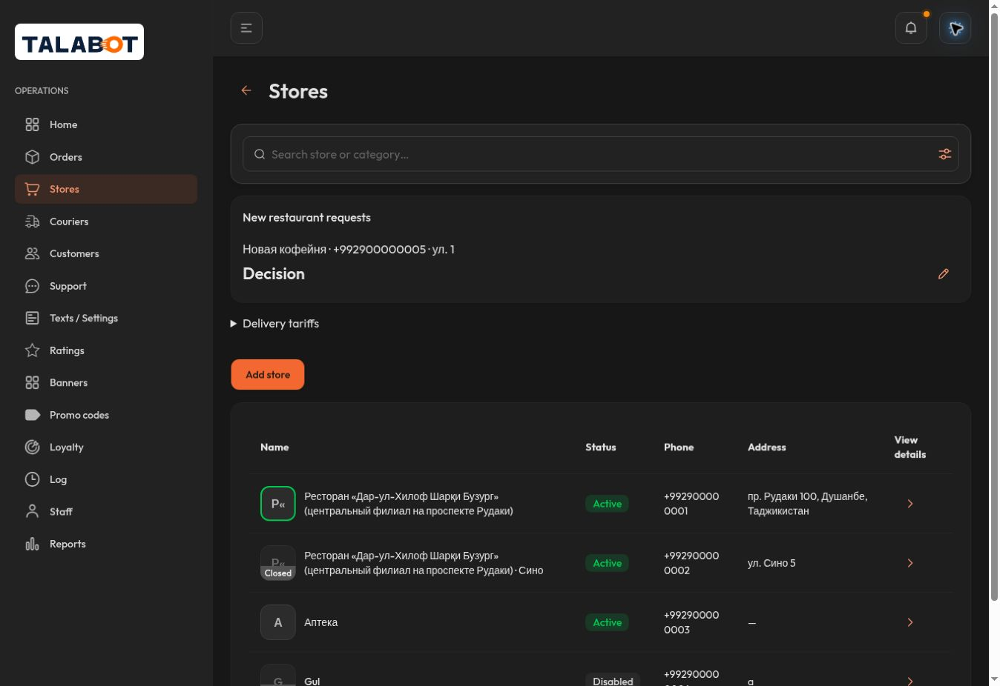 |

البديل يحتفظ بـ#F36831، ويغير النص إلى درجة B الداكنة. لا اعتماد نهائي للبديل.

## Q40 — روابط الإشعارات

| Light — قبل | Light — البديل |
|---|---|
| 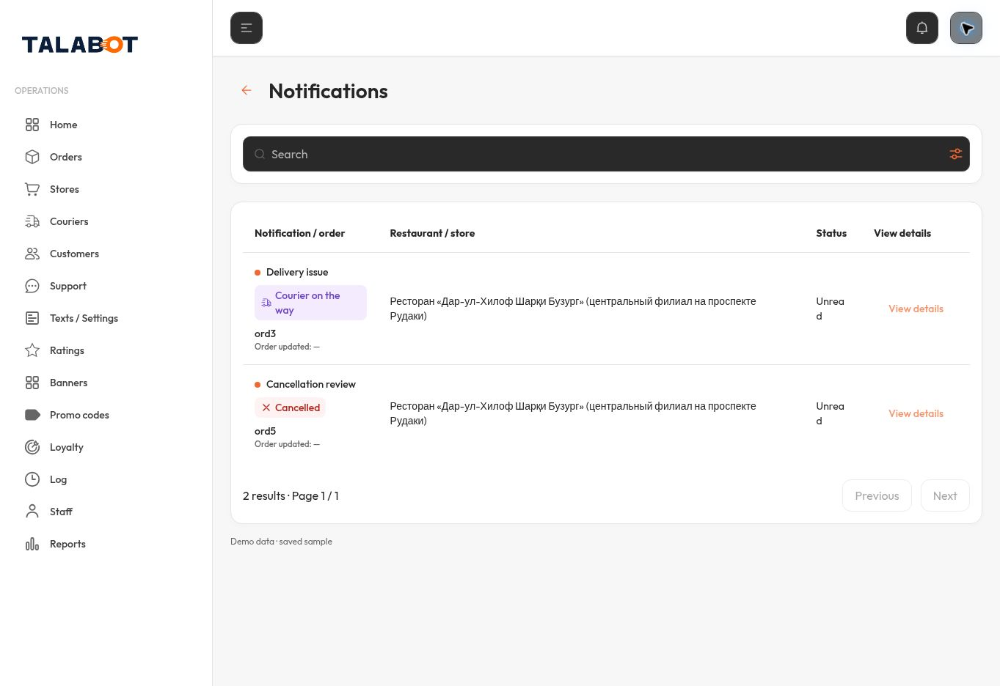 | 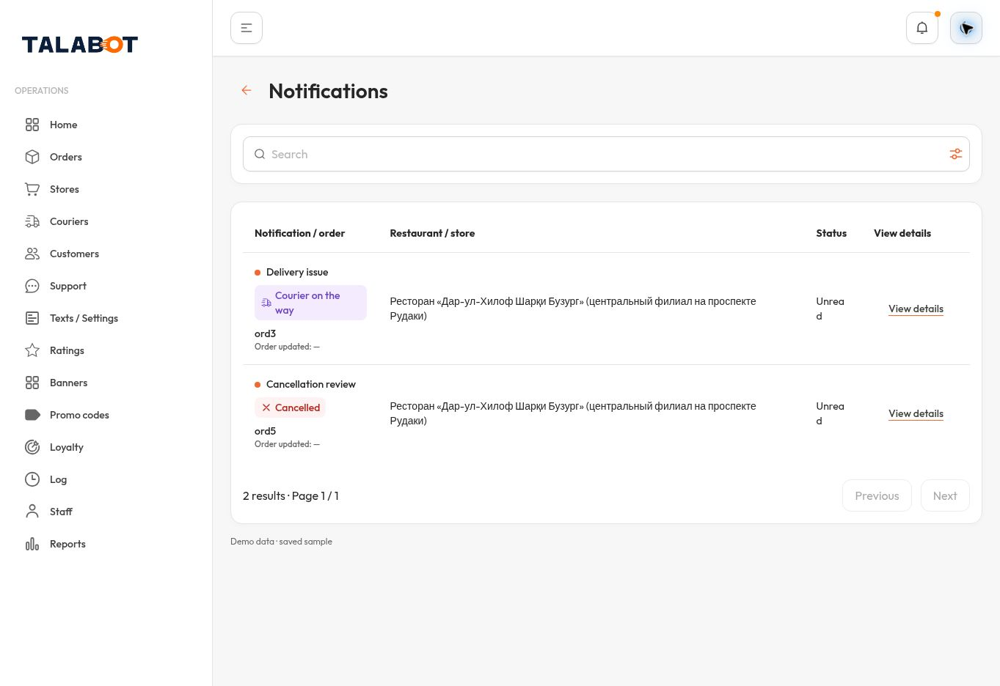 |

| Dark — قبل | Dark — البديل |
|---|---|
| 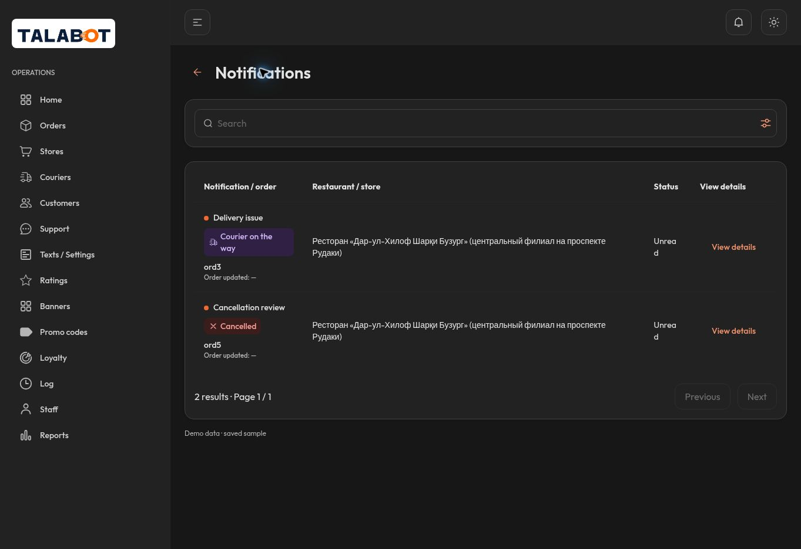 | 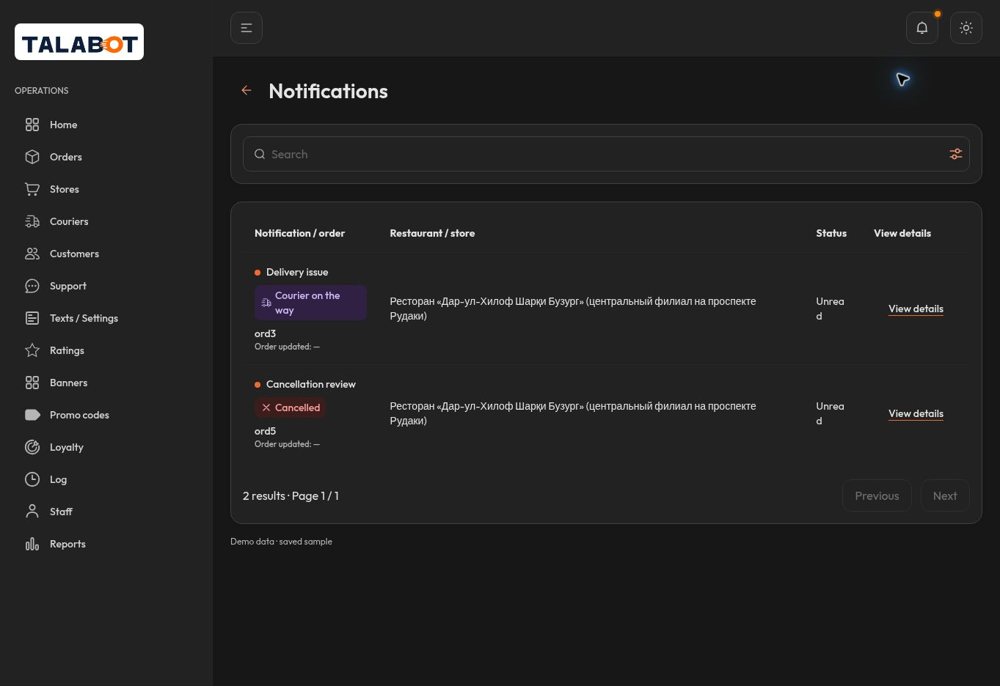 |

## V01 — الطلبات

| Light | Dark |
|---|---|
| 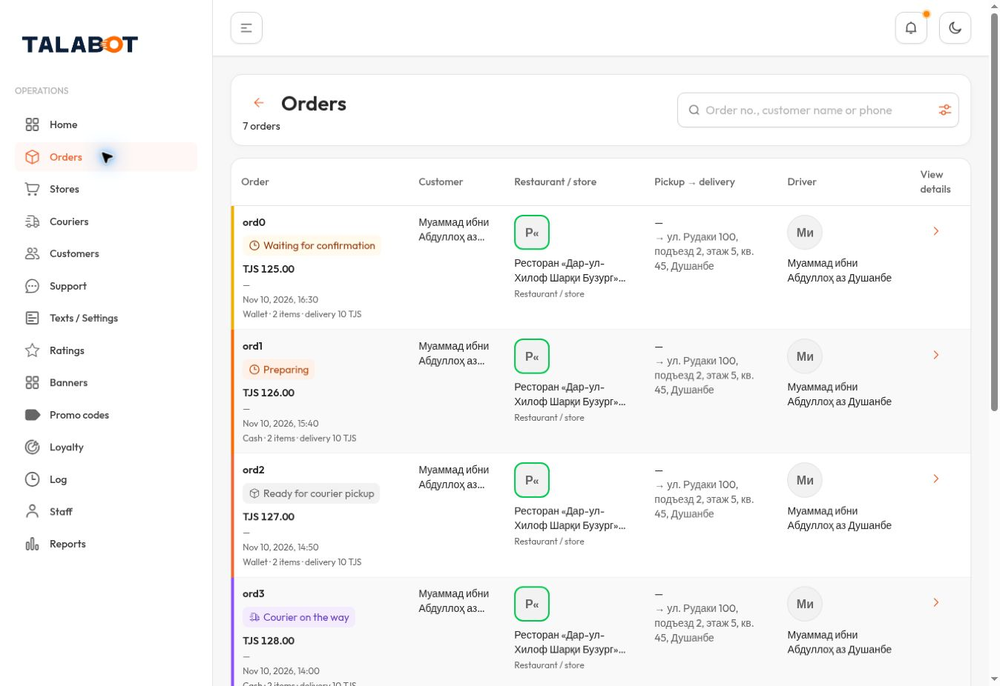 | 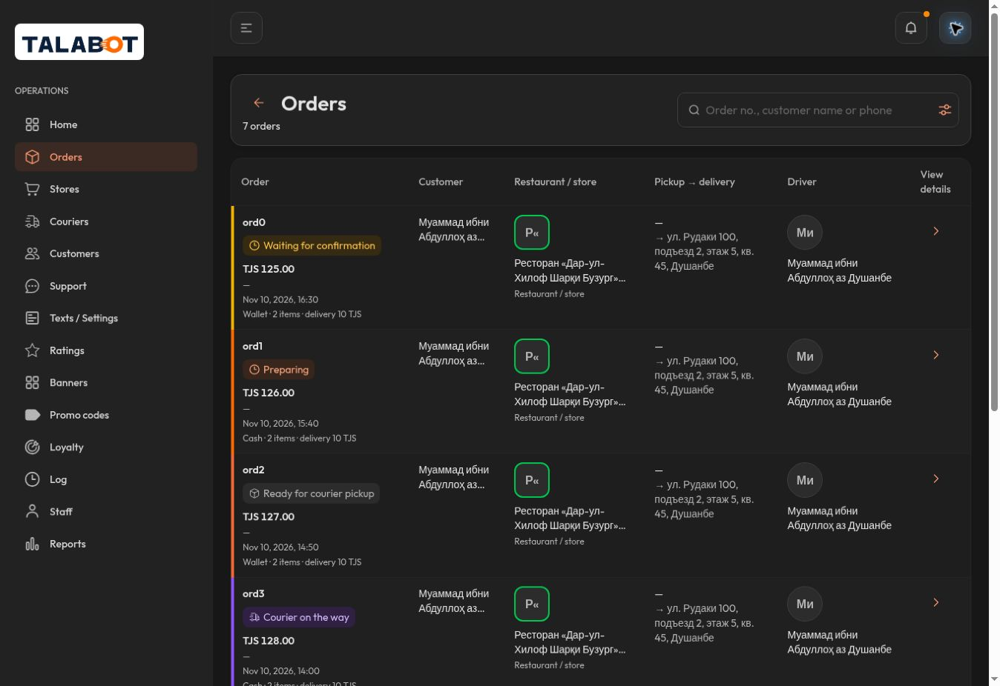 |

[الأسماء الكاملة في التفاصيل](evidence/order-details-full-names-dark.jpg). [القياسات والرجوع](evidence/metrics.json).

## V03 — إغلاق الجرس

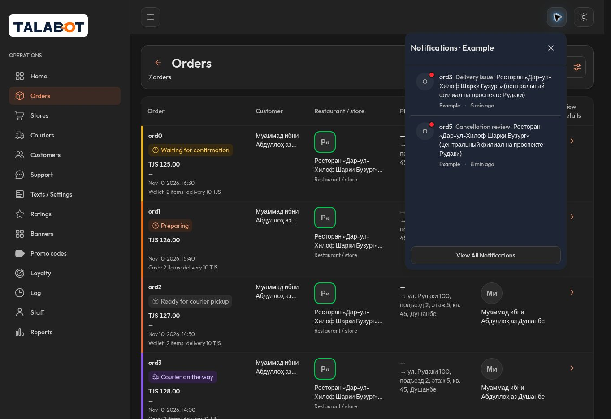

## V05 — رؤوس الأعمدة الفعلية

| اللغة | السائقون Light / Dark | الإشعارات Light / Dark |
|---|---|---|
| EN | [Light](evidence/drivers-en-light.jpg) / [Dark](evidence/drivers-en-dark.jpg) | [Light](evidence/notifications-after-light.jpg) / [Dark](evidence/notifications-after-dark.jpg) |
| RU | [Light](evidence/drivers-ru-light.jpg) / [Dark](evidence/drivers-ru-dark.jpg) | [Light](evidence/notifications-ru-light.jpg) / [Dark](evidence/notifications-ru-dark.jpg) |
| TG | [Light](evidence/drivers-tg-light.jpg) / [Dark](evidence/drivers-tg-dark.jpg) | [Light](evidence/notifications-tg-light.jpg) / [Dark](evidence/notifications-tg-dark.jpg) |

عناوين الأعمدة لا تتكرر داخل أي جدول. هذا ليس قبولاً لترجمة كل عناصر الشاشة؛ fallback الروسي السابق لبعض عناصرTG ظاهر ومحفوظ.

## فهرس الصور

| الملف | المصدر | اللغة | الثيم | DOM viewport | بكسلات الصورة |
|---|---|---|---|---|---|
| [q40-stores-before-light](evidence/q40-stores-before-light.jpg) | `f28c80e` | en | light | 1363×936 | 1348×926 |
| [q40-stores-before-dark](evidence/q40-stores-before-dark.jpg) | `f28c80e` | en | dark | 1363×936 | 1348×926 |
| [notifications-before-dark](evidence/notifications-before-dark.jpg) | `f28c80e` | en | dark | 1363×936 | 1363×936 |
| [notifications-before-light](evidence/notifications-before-light.jpg) | `f28c80e` | en | light | 1363×936 | 1363×936 |
| [q40-stores-after-dark](evidence/q40-stores-after-dark.jpg) | `f0d723a` | en | dark | 1363×936 | 1348×926 |
| [q40-stores-after-light](evidence/q40-stores-after-light.jpg) | `f0d723a` | en | light | 1363×936 | 1348×926 |
| [orders-after-light](evidence/orders-after-light.jpg) | `f0d723a` | en | light | 1363×936 | 1348×926 |
| [orders-after-dark](evidence/orders-after-dark.jpg) | `f0d723a` | en | dark | 1363×936 | 1348×926 |
| [order-details-full-names-dark](evidence/order-details-full-names-dark.jpg) | `f0d723a` | en | dark | 1363×936 | 1363×936 |
| [bell-close-dark](evidence/bell-close-dark.jpg) | `f0d723a` | en | dark | 1363×936 | 1363×936 |
| [notifications-after-dark](evidence/notifications-after-dark.jpg) | `f0d723a` | en | dark | 1363×936 | 1363×936 |
| [notifications-after-light](evidence/notifications-after-light.jpg) | `f0d723a` | en | light | 1363×936 | 1363×936 |
| [q40-notification-detail-light](evidence/q40-notification-detail-light.jpg) | `f0d723a` | en | light | 1363×936 | 1363×936 |
| [q40-notification-detail-dark](evidence/q40-notification-detail-dark.jpg) | `f0d723a` | en | dark | 1363×936 | 1363×936 |
| [drivers-en-dark](evidence/drivers-en-dark.jpg) | `f0d723a` | en | dark | 1363×936 | 1363×936 |
| [drivers-en-light](evidence/drivers-en-light.jpg) | `f0d723a` | en | light | 1363×936 | 1363×936 |
| [drivers-ru-light](evidence/drivers-ru-light.jpg) | `f0d723a` | ru | light | 1363×936 | 1363×936 |
| [drivers-ru-dark](evidence/drivers-ru-dark.jpg) | `f0d723a` | ru | dark | 1363×936 | 1363×936 |
| [notifications-ru-dark](evidence/notifications-ru-dark.jpg) | `f0d723a` | ru | dark | 1363×936 | 1363×936 |
| [notifications-ru-light](evidence/notifications-ru-light.jpg) | `f0d723a` | ru | light | 1363×936 | 1363×936 |
| [drivers-tg-light](evidence/drivers-tg-light.jpg) | `f0d723a` | tg | light | 1363×936 | 1363×936 |
| [drivers-tg-dark](evidence/drivers-tg-dark.jpg) | `f0d723a` | tg | dark | 1363×936 | 1363×936 |
| [notifications-tg-dark](evidence/notifications-tg-dark.jpg) | `f0d723a` | tg | dark | 1363×936 | 1363×936 |
| [notifications-tg-light](evidence/notifications-tg-light.jpg) | `f0d723a` | tg | light | 1363×936 | 1363×936 |

التسجيل الآلي للمصدر وهاش الصورة والعينة وعناوينDOM في [evidence-manifest.json](evidence-manifest.json). الصور الأصلية لم تُعدّل أو يُغيّر مقاسها. Safari/iPhone و320/390/1440: NOT TESTED.
