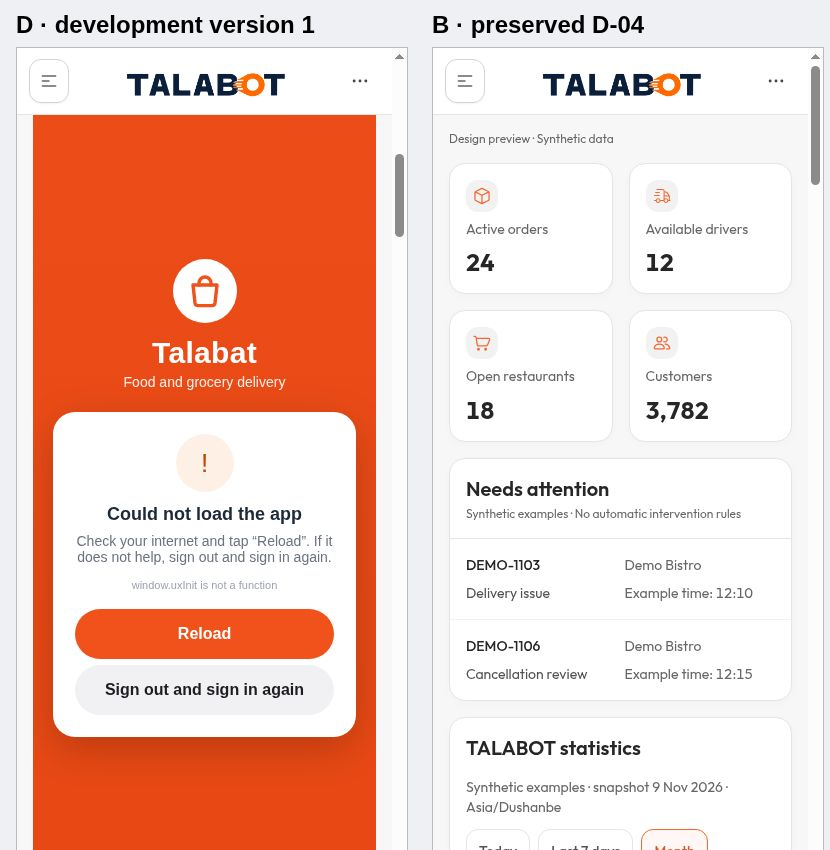
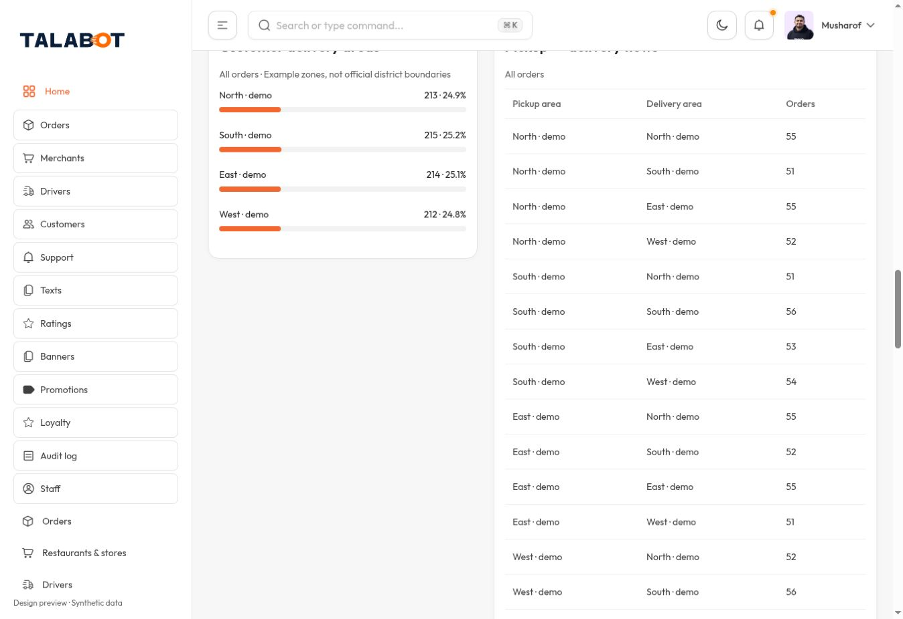
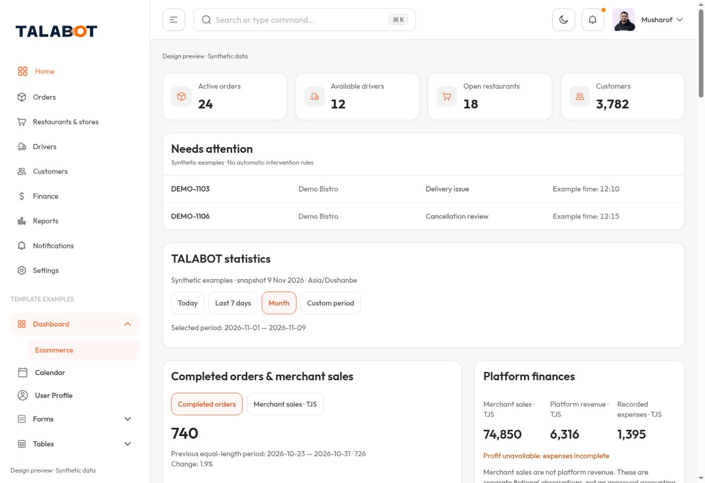

# TALABOT UX-02 — تشخيص اتجاه D

الحالة: DEVELOPMENT / NOT ACCEPTED — توقفت التغييرات البصرية والنشر عند توجيه المالك. لم تُعدّل A/B/C أو الإنتاج.

## النسخ والحفظ
- D المنشورة: https://talabot-admin-ux02-unified-d.alwarikahtan.chatgpt.site/ — الإصدار 1.
- مصدر الإصدار المنشور: `6782f98f98e9996934f45968ef0013eda0060561`.
- أحدث مصدر Sites محفوظ وغير منشور: `690255c1318cc40322c89b3db914d06101934e8d`.
- تجميد المصدر على GitHub، متحقق منه عن بُعد: `5faf6086afbe1f4921c2359a137356007b0e2eff`.
- المستودع: merapplications-sketch/talabot-tailadmin-review.
- الفرع: review/ux02-controlled-recovery-20261110.
- B: https://talabot-admin-d04-order-review.alwarikahtan.chatgpt.site/ — مصدر 8dc0f4c30d1a390ec1c81c440b03f5ff9c549f87.

الصورة تمثل إصدار تطوير أول، وليست صفحة نهائية أو اعتماد UX-02. إصلاح تهيئة محفوظ قبل التوقف لم يُنشر. لا توجد تصحيحات بصرية منفذة بعد التوجيه الأخير.

## المقارنة مع UX-01

| الفرق المثبت | السبب والموضع | الإصلاح المقترح فقط، ينتظر مراجعة المالك |
|---|---|---|
| تكرار الملاحة | أضيفت OperationsLinks لأقسام A الاثني عشر داخل PreviewSidebar مع إبقاء قائمة B، ثم أعيدت الشبكة داخل الرئيسية | خريطة ملاحة واحدة تصل لجميع أقسام A، وإزالة تكرار روابطها من الرئيسية دون حذف أقسام أو وظائف |
| استهلاك مساحة كبيرة | قائمة A ثم قائمة B وأمثلة القالب؛ شبكة الرئيسية المكررة بارتفاع نحو 208px على الكمبيوتر و316px على الهاتف، مع مقدمة طويلة | تنظيم الملاحة القائمة في مجموعات واضحة، واختصار تنبيه البيانات الاصطناعية مع تفاصيل قابلة للفتح |
| بطاقات A محجوبة بصرياً | ترتيب المصدر صحيح: Orders / Revenue / Commission / Active قبل الطلبات. لكن الإصدار المنشور يستدعي window.uxInit قبل تحميلها؛ طبقة التحميل تبقى فوق iframe | مراجعة إصلاح التهيئة المحفوظ ثم التحقق من ظهور البطاقات الأربع أعلى المحتوى. لا نشر الآن |
| الوصول للطلبات والتنبيهات غير مريح | العمليات داخل iframe أسفل المقدمة، مع مسارات طلبات A وأمثلة B منفصلة وطبقة التحميل | إبراز التنبيهات والطلبات بعد المؤشرات مباشرة وربط الملاحة بمسار عمليات واحد، مع تمييز الأمثلة |
| تحليلات B موجودة لكن بعيدة | AnalyticsDashboard بالكامل بعد إطار العمليات وشبكة الروابط المكررة؛ analytics.tsx وanalytics-data.ts مطابقان لمرجع B بايتياً | الحفاظ على جميع التحليلات والمخططات؛ تحسين موضعها بعد إزالة التكرار فقط بموافقة المالك |
| تفاوت الأيقونات والبطاقات والمسافات | إطار A/C القديم يستخدم CSS وأيقونات مستقلة عن مكونات React في B | توحيد العرض على نظام B مع الحفاظ على معالجات A ووظائفها، دون تغيير الهوية أو قواعد الأعمال |
| سياق Transcom جزئي | شرح عام للسياق والخطوة التالية وليس إجراءً تالياً مرتبطاً بحالة كل مهمة | عرض السياق والإجراء القائم المسموح وسبب التعطل بحسب الحالة؛ لا ابتكار انتقالات أو صلاحيات |

سبب الملاحة المكررة خطأ في تركيب التنفيذ: جُمعت وسائل الوصول السابقة بدل توحيدها. ليس مطلباً في المواصفة المعتمدة.

## موضع المؤشرات والتحليلات

ترتيب الرئيسية الحالي: تنبيه المراجعة → إطار عمليات A/C (مؤشرات A الأربع ثم العمليات) → شبكة روابط A مكررة → تحليلات B كاملة → أمثلة مؤشرات B والتنبيهات.

احتفاظ ملفات تحليلات B كاملاً مثبت بمقارنة المصدر واختبارات البيانات؛ هذا لا يثبت سلامة كل تفاعل في الصفحة المنشورة. لم تُحذف تحليلات أو أقسام لحل مشكلة المساحة.

## المقارنة المرئية

الهاتف: D يساراً وB يميناً، إطار 390px؛ عرض المحتوى الداخلي 375px بسبب شريط التمرير. Chromium، EN، Light، وليس iPhone فعلياً.

الكمبيوتر: عرض المحتوى نحو 1348 CSS px. قياس إطار 1440 تم، لكن التقاط الصفحة الكاملة عنده انتهى بمهلة؛ لا يُسجل نجاح فحص 1440 الكامل.

### D الحالية

### B المرجعية

الكتلة البرتقالية في D طبقة تحميل عالقة فوق العمليات، وليست مبرراً لاعتماد الشكل أو الحكم بأن بطاقات A حُذفت.

## الاختبارات والأدلة المحفوظة

- Build: ناجح للمصدر الأحدث المحفوظ؛ docs/ux02/build.log.
- Lint: صفر أخطاء و45 تحذيراً؛ أصلح no-this-alias دون تعطيل القاعدة. التصنيف: 40 متغيراً غير مستخدم، 1 anonymous export، 3 تنبيهات صور Next، 1 تنبيه ملاحة. السجل السابق 47 تحذيراً محفوظ للمقارنة.
- حماية ثابتة: 15 فحصاً ناجحاً، تشمل أسماء الوظائف ومعالجات A ومعرّفات العناصر والأقسام الاثني عشر ومصفوفة37 وعدم تغيير ملفي تحليلات B. هذه ليست بديلاً لاختبار كل وظيفة تفاعلياً.
- بيانات تحليلات B: 12 اختباراً ناجحاً.
- تفاعل المتصفح: جزئي فقط؛ فلاتر Today/Week/Monday لوحظ تغيرها. الفترة المخصصة غير محسومة؛ لا نجاح شامل للتفاعل.
- الإصدار المنشور: خطأ تهيئة مثبت وطبقة تحميل تحجب العمليات. لا يُعتبر ناجحاً أو جاهزاً للاعتماد.
- 320 واللغات والمظهر والرجوع وحفظ حالة الملاحة وجميع الوظائف: لم تكتمل أدلة اختبارها؛ لا يُدّعى نجاحها.
- لا اختبار Safari/iPhone فعلي.

## نقطة الاستئناف

ابدأ من Commit المصدر المجمد 5faf6086afbe1f4921c2359a137356007b0e2eff والفرع أعلاه. راجع هذا التقرير مع المالك أولاً. لا تنفذ اقتراحات الشكل ولا تنشر المصدر الأحدث قبل مراجعته للفروق. المرجع UX-01 ومصفوفة37 محفوظان ضمن docs/ux02؛ لا إعادة فتح القرارات المعتمدة.
