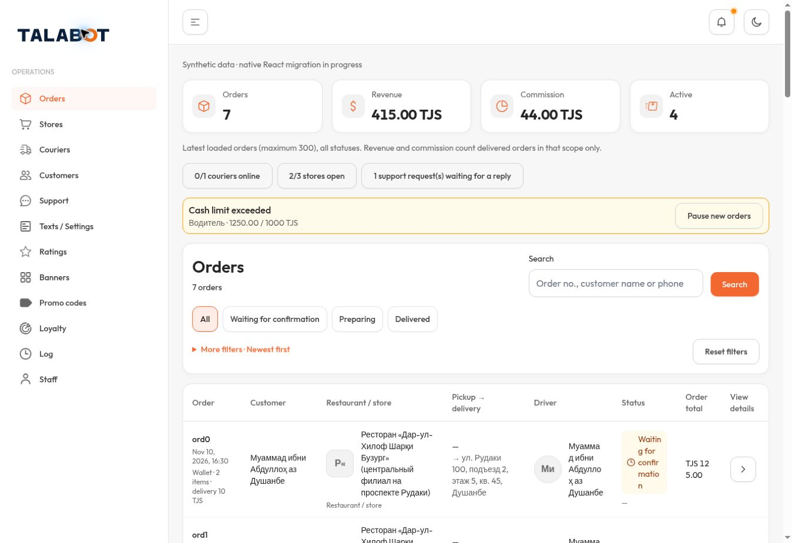
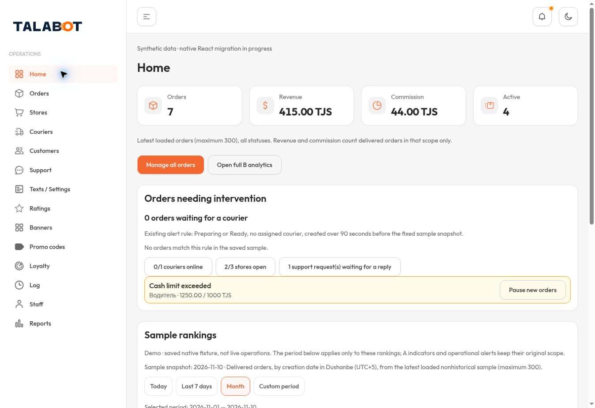
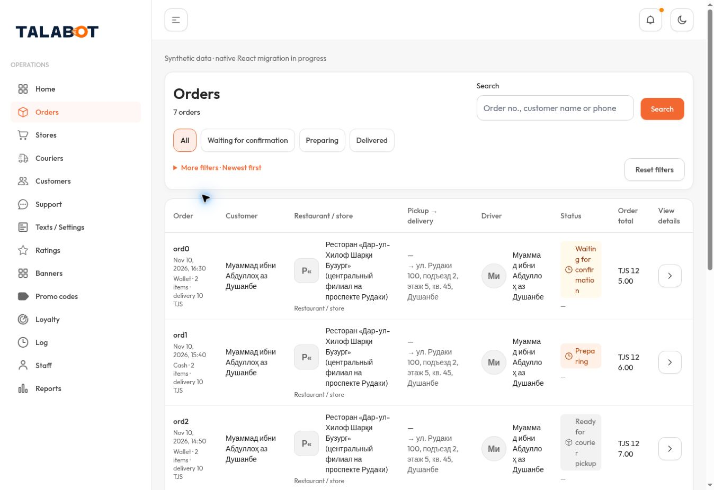
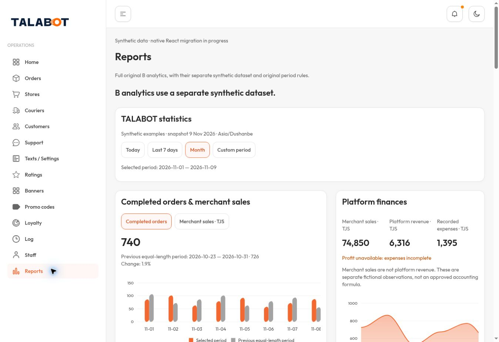
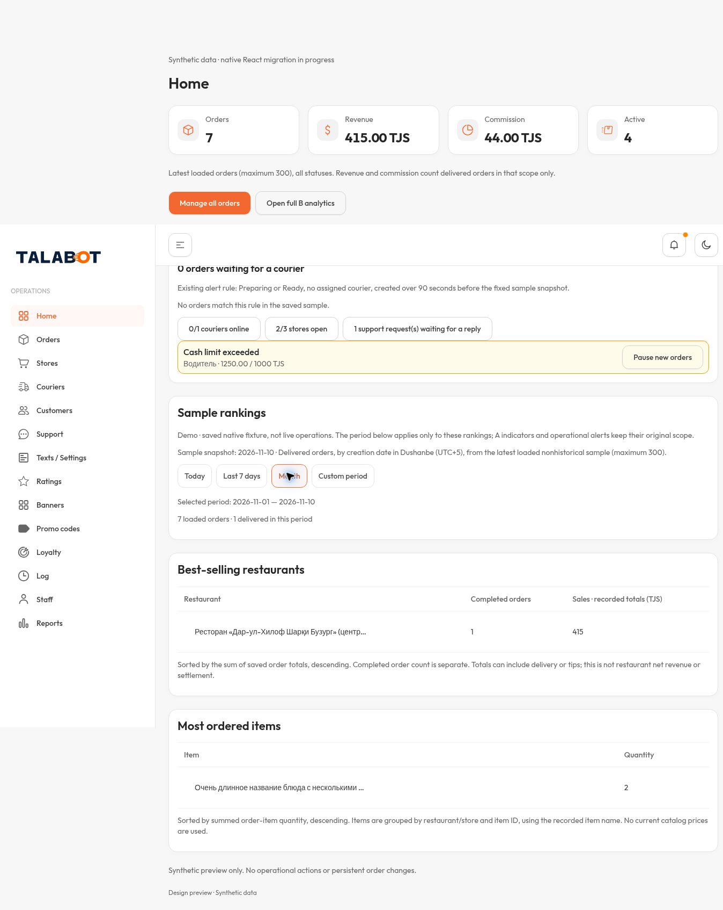

# Desktop evidence — actual1363×936 only

All new UI screenshots were taken in the managed local preview from the published source. Hosted owner-private runtime showed the sign-in gate, so these are not labelled authenticated hosted screenshots. No phone,320,390,1440 or Safari screenshots exist for this batch.

## Previous v11 (preserved published evidence)

## New Home

## Orders only

## Full original B Reports

## Full-page Home capture
This supplementary browser full-page capture was taken while scrolled. Fixed/sticky navigation appears at the capture scroll position; use the viewport image above for the top-of-page layout.

