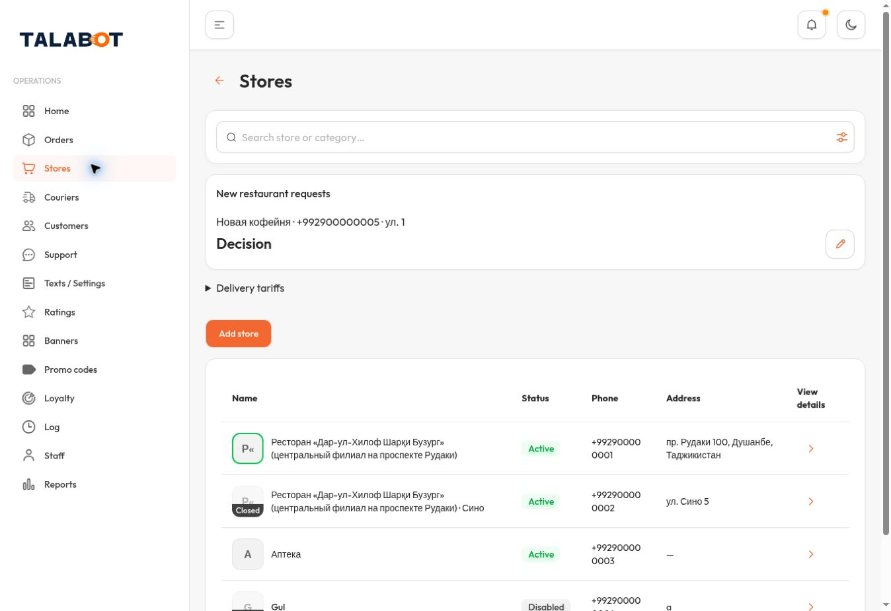
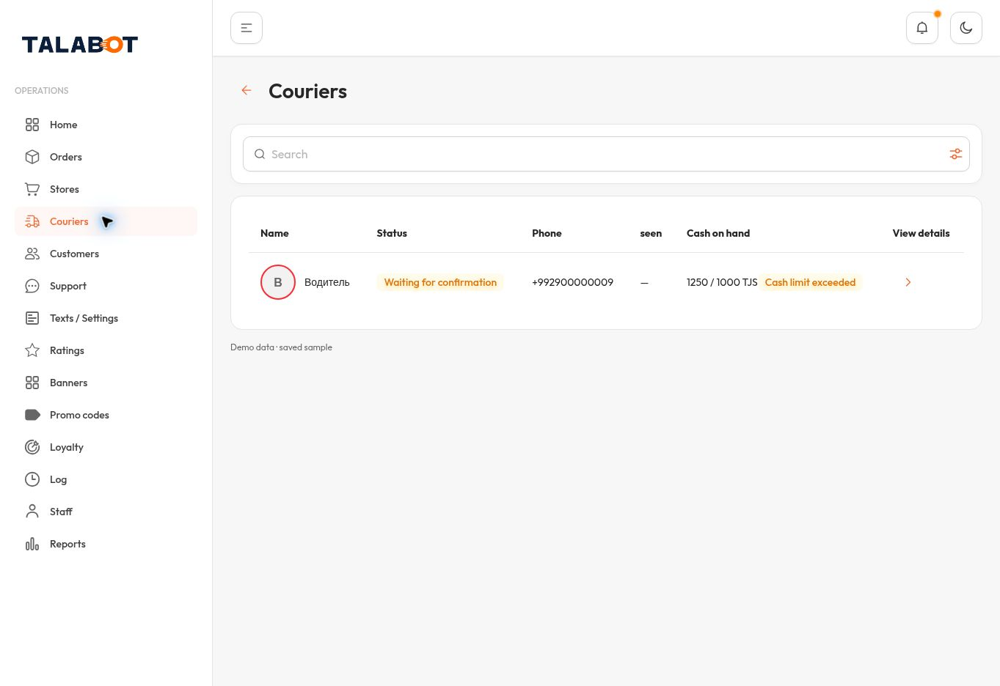
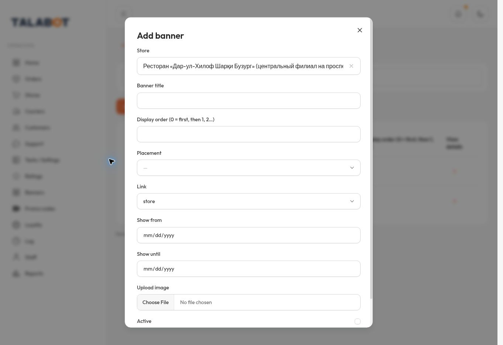

# Owner refinement — published delivery

Date: 2026-11-11 UTC. Status: READY FOR OWNER VISUAL REVIEW, not final acceptance.

## Source and publication

- Repository: merapplications-sketch/talabot-tailadmin-review
- Branch: review/ux02-owner-refinement-20261111
- Executable source commit: 02f9815be9970172b71d509688a286c3c914da02
- Parent: 3f6fd4a6b322e267c3bba6c7a6730079119b20ba
- Source tree: 3589fb631c74cca0cfec1e2102ae07b8a7adb665
- All 27 changed/new source/test/handoff file blob hashes matched the canonical tree after commit. No source files changed after the successful build.
- HTTPS: https://talabot-ux02-refined-review.alwarikahtan.chatgpt.site
- Site: appgprj_6af4b9697dc88191a4992df2cc6c89d7
- Published version: 1
- Version ID: appgprj_6af4b9697dc88191a4992df2cc6c89d7~appgver_71e19ea99d50819194097b4ae3018ddc
- Deployment: appgdep_6af4ba377e3481918cf3035cb5acbd5c — succeeded
- Artifact source commit: 73ea3b0169fcc9da426d24d161c228e3689aac4d
- Archive SHA256: 4fd5e32aa9a5bbe48044e8240cc3023968f84ac547443d1d7d6c8011dae5fbb8
- Deployed JS observed in browser: /assets/index-B9l_mvB-.js, matching this build. The artifact includes SOURCE.json with canonical provenance.
- The direct new URL opened the application without a ChatGPT sign-in screen in the available browser. Real Safari behavior is NOT TESTED.
- Old compact-review Site was reread after publication: version 1, same URL and audience. No old Site, v11, A/B/C/D2, production or main was updated.

## Requested differences

| Area | Delivered change | Remaining limit |
|---|---|---|
| Merchant image | Green border directly follows rounded image edge; click opens linked current banner | Existing sample banner has no image data |
| Closed state | Gray image with Closed overlay; duplicate adjacent open/closed badge removed | Account Active/Disabled semantics unchanged |
| Driver image | Red/green circular boundary replaces status dot | Sample has no uploaded driver photo; live upload roundtrip untested |
| Actions | Orange pencils, maps, detail arrows and Add store; green calls; yellow rating stars | Existing brand and B components retained |
| Metrics | Four Home A cards and four top Reports B cards navigate with compact Back | No relocation of B cards onto Home |
| Orders | Mobile essentials-only cards, full modal details; elapsed journey text below timestamp | Mobile geometry and actual Safari untested |
| Search/filter | Shared compact field, orange internal filter, corrected focus; merchant/driver/customer/rating filters | Select pointer/touch coverage incomplete; see verification |
| Rankings | Existing period plus merchant search and all eight existing categories | Original saved-total/quantity calculations preserved |
| Banner entry | Immediate B form, searchable merchant first; preselected from store details | No hosted write operations enabled |
| Promo entry | Immediate existing form from store details, explicit platform-wide scope | Merchant-restricted promo contract is absent; not invented |
| Map block | Address, coordinates and existing actions grouped; orange map icon | No map/provider or business rule change |

Delivery tariffs means the delivery-fee configuration by distance. Existing fields are delivery_free_km, delivery_step_km, delivery_step_price, delivery_max_km and delivery_road_factor. The UI work does not change their values or formulas.

## Verification and evidence

- TypeScript noEmit, native build (835 modules), git diff whitespace check: PASS.
- New refinement checks 7; list journey checks 15; shared composition 7; audit SSR 7; shared search/identity checks: PASS.
- Existing operations 17, Home calculations 7, banner linkage 7, closure state checks 7, invoice/contact/translation/saved-wallet-vs-cash assertions: PASS on synthetic local inputs. No claim of backend financial acceptance.
- Local-browser checks before publication covered Home/Reports metric navigation and Back, directories, search/filter persistence, detail close, banner/promo entry and orange/yellow/green semantics.
- Published browser checks: ranking category Pharmacy selected by keyboard and applied; store image opened linked banner; Close restored Stores; store detail opened Add banner directly with s1 preselected; search for Аптека returned its option and clicking it changed selected hidden ID to s3; X restored the original store detail, then list. Couriers navigation and compact Back restored Stores.
- Browser Select semantic-click timing/highlight behavior was inconsistent in automation. No application cause was proved. Keyboard category selection and merchant option click were verified. Actual pointer/touch behavior on iPhone remains untested; no alternative browser transport or restriction bypass was used.
- Published driver boundary measured 48x48 with circular radius and red offline color. Earlier merchant boundary measurement was 48x48, zero parent offset, 12px rounded corners. Search input/group each 48px, no oversized focus outline.
- Actual browser viewport: Chromium 1363x936. Driver page scrollWidth 1363, no horizontal overflow in that observed desktop view.
- 320: NOT TESTED. 390: NOT TESTED. 1440: NOT TESTED. Real iPhone Safari: NOT TESTED. Available browser did not expose supported viewport emulation.
- Owner's iPhone screenshots in the conversation are BEFORE/reference evidence; they are not after-test evidence. No fabricated phone screenshots or before/after mobile measurements are supplied.

Screenshots are unmodified browser JPEG bytes, with hashes in evidence/manifest.json:

## Outfit and protected functions

Browser computed font: Outfit, sans-serif. Original two WOFF2 assets remain unchanged:

- outfit-c8e7a734.woff2 — Git blob 48aae950fc21da407d5577e7ce63e028bf9bb205, 32228 bytes.
- outfit-f37fa50e.woff2 — Git blob 8fa75fd9ee81a8da01698d1d3400670bb8d508d7, 14760 bytes.

The 37-function matrix retains its previous classification; this UI delivery does not claim 37/37. FP07, FP09, FP27, invoice, orange journey, driver assignment, publication guards, pharmacy flow and financial/permission contracts are preserved. See HANDOFF.md for the prior matrix references.

Stop point: isolated preview awaiting owner iPhone visual approval. Resume from current remote branch HEAD and CHECKPOINT.md, without merging main or starting FP16.
