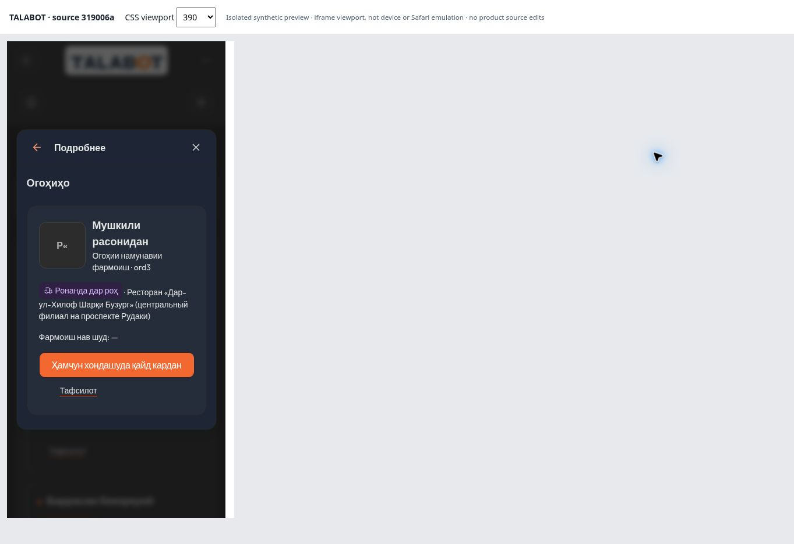
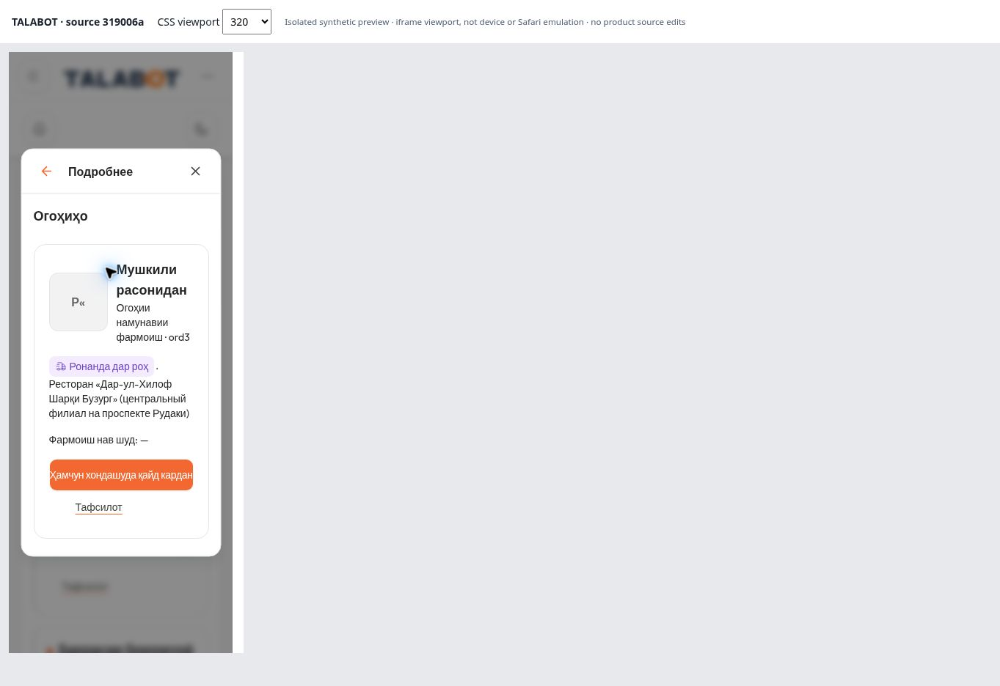

# Owner-requested single-line button — 2026-11-13

Based on 621038ec960746d217a87f594eb8342aaa8200e6. Owner explicitly requested the smaller, regular white Continue-like label after being told that reducing text size changes the previous contrast qualification.

Only notification Mark as read uses the new lg-single size: full available width, height44px, weight400, 14px below375px and16px from375px; single line, original white and orange. The existing B font is retained; exact font family cannot be identified from the supplied raster reference. Add store, V04, functions, translations and global brand tokens are unchanged. No new gradient or brand change. Previous wrapping size retained as an existing primitive, no longer used here.

Contrast remains3.072235577:1, but this smaller regular text does NOT pass WCAG AA normal-text4.5:1. The previous large-bold3:1 acceptance does not apply to this owner-requested variant. This is a documented visual choice, not a technical contrast PASS.

Direct checks: TG (longest label),320/390×820,Light/Dark, desktop Chrome CSS iframe; four cases have one text rectangle entirely inside the button,44px height. At320 text fits tightly; physical Safari and font/rendering differences are untested. RU/EN,1440, hover/focus/activation/disabled were not re-executed in this delta; handlers and their state colors are unchanged. Build native and source TypeScript PASS, diff check PASS. Source blob hashes and screenshot SHA256 are in metrics.json. Harness header319006a is historical harness text; source blobs identify actual tested code. Harness removed before build.

[Before](../pm-ux02-01-fix-20261112/evidence/after-tg-dark-390.jpg) / [After](tg-dark-390.jpg)

GitHub save only on review/ux02-v01-v05-candidate-20261112; no deployment, main merge, access changes or force push.
