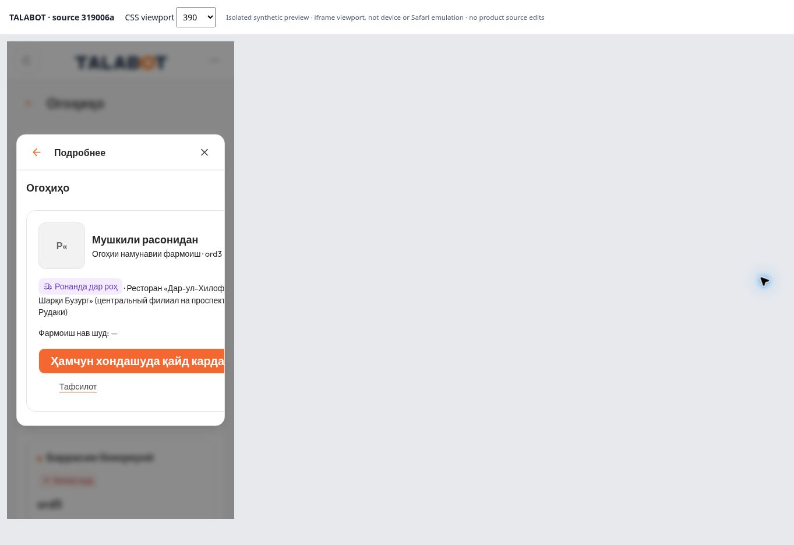

# TALABOT — UX-02 / PM direct browser evidence

تاريخ الفحص: 2026-11-12. الحالة: **PARTIAL — PM-UX02-01 correction required**.

هذا تقرير مشاهدة الإدارة المباشرة، مستقل عن إعلان المصمم، لكنه لا يحل محل حكم مدقق التصميم المسمّى. لا قبول شامل لـ UX-02 ولا تغيير لقرار المالك.

## المرجع والبيئة

- تسليم المصدر: `319006a420e12c23be2d3cc3baaa2532614280ae`؛ التنفيذ: `4a36654cb4b45a01fe28ad5b91aad9b95d4654ac`.
- المستودع: `merapplications-sketch/talabot-tailadmin-review`؛ الفرع: `review/ux02-v01-v05-candidate-20261112`.
- Chromium مكتبي؛ صفحة اختبار منفصلة تعرض التطبيق في iframe بعرض CSS حقيقي 320/390/1440 وارتفاع 820. **ليست محاكاة جهاز أو Safari أو لمس فعلي.**
- بيانات native-preview الاصطناعية؛ لا اتصال مقصود بالبيانات الحية ولا إنشاء متجر أو إرسال مالي.
- بدأ الفحص بعد تفعيل قناة المعاينة المحلية المُدارة والوصول إلى المصدر الحالي؛ التبويب القديم ذي النص الداكن ليس دليل هذه الحزمة. أوقفت معاينة الإدارة بعد الفحص؛ لا رابط نشر جديد.
- نسخة المصمم الأصلية بقيت نظيفة عند 319006a. اللقطة المعزولة: 1858/1859 ملفًا مطابقًا حرفيًا؛ الفرق الوحيد في ملف متتبع هو scripts.dev في package.json لتشغيل إعداد الاختبار المحلي. أضيف إعداد Vite مساعد وملف iframe مستقل؛ لم يتغير مكوّن أو CSS أو مصدر منتج. [إيصال المطابقة](source-verification.json).
- تم استعمال الاعتماديات المثبتة دون تثبيت جديد أو إعادة البناء/الاختبارات المقبولة. رفض بيئة DevTools لم يُتجاوز ولم تُغيّر سياسة المتصفح.

## النتيجة المحددة

36 حالة افتراضية = زران × EN/RU/TG × Light/Dark × 320/390/1440. تمت مشاهدة الأزرار وحفظ صورها وقياسات DOM. **30 حالة اتساع ناجحة و6 حالات قص**؛ هذا عدّ لاتساع هذين الزرين فقط، وليس نسبة نجاح التطبيق.

| الزر / اللغة | 320 Light/Dark | 390 Light/Dark | 1440 Light/Dark |
|---|---|---|---|
| إضافة متجر EN | PASS / PASS | PASS / PASS | PASS / PASS |
| إضافة متجر RU | PASS / PASS | PASS / PASS | PASS / PASS |
| إضافة متجر TG* | PASS / PASS | PASS / PASS | PASS / PASS |
| تحديد كمقروء EN | PASS / PASS | PASS / PASS | PASS / PASS |
| تحديد كمقروء RU | **CLIPPED / CLIPPED** | PASS / PASS | PASS / PASS |
| تحديد كمقروء TG | **CLIPPED / CLIPPED** | **CLIPPED / CLIPPED** | PASS / PASS |

*في إعداد TG، تسمية إضافة متجر تستخدم fallback الروسي «Добавить магазин». نجاح الاتساع لا يعني اكتمال الترجمة. لا تُفتح دورة ترجمة جديدة بهذه الملاحظة.

### PM-UX02-01 — قص زر تحديد كمقروء داخل النافذة

- إعادة الإنتاج: افتح native-preview، اختر RU أو TG، ثم Notifications → View All Notifications → إشعار العينة native-ord3 غير المقروء، بعرض 320؛ وفي TG كرر عند 390. يظهر القص في Light وDark.
- RU/320: يسار الزر54، يمينه331.875، عرضه277.875؛ يمين النافذة304 وoverflow-x:hidden. النص والزر مقصوصان عند الحافة، رغم أن عرض المستند نفسه لا يتجاوز viewport.
- TG: عرض الزر352.203125؛ يمينه406.203125 عند320، و390.203125 عند390؛ الصور تثبت القص داخل النافذة. لا يُعتبر document.scrollWidth وحده إثبات غياب القص.
- النص الافتراضي المرصود أبيض #FFFFFF، حجم20px/وزن700، ارتفاع44px، والخلفية #F36831. يحافظ الإصلاح على قبول البرتقالي ووضوح النص؛ لا تصغير صامت يُسقط أساس التباين المقبول.
- النتيجة: عيب فني مثبت ضمن تصحيح V02 الجاري، وليس طلب تحسين ذوقي أو تراجعًا عن قبول المالك.



## التفاعل الذي نُفذ

| الفحص | النتيجة / حدودها |
|---|---|
| Add store، EN Light 320 | النقر فتح Details / Add store. لم يُنشأ متجر ولم يُختبر حفظ نموذج أو CRUD؛ FP16 لا يُغلق. |
| Mark as read، EN Light 320 | انتقال لوحة المفاتيح إلى الزر أظهر focus-visible. لا يثبت حلقة التركيز الكاملة داخل النافذة. |
| Mark as read، EN Light 390 | hover=true موثق، ثم focus-visible=true بعد Shift+Tab وTab. |
| تفعيل الزر نفسه بـEnter | تغير النص إلى Read وأصبح disabled=true في بيانات العينة المحلية. لا إثبات حفظ خادم/تشغيل حي. |

ألوان hover/disabled في measurements.json هي لقطة من زمن الالتقاط وقد تقع خلال انتقال CSS؛ لا تستخدم وحدها لإصدار حكم تباين نهائي لهذه الحالات. لم يُلتقط الضغط المستمر active.

## المتبقي وحدود الحكم

- **ACCEPTED (نطاق إدارة محدود):** توفر قناة الفحص الحالية؛ صور وقياسات الحالات36؛ وصول إضافة متجر في العينة؛ التركيز والتفعيل والتعطيل في الحالة الإنجليزية المذكورة.
- **PARTIAL:** V02 بسبب PM-UX02-01 وحالات التفاعل غير المغطاة؛ UX-02 يبقى جزئيًا.
- **BLOCKED / NOT TESTED في هذه الحزمة:** Safari/iPhone/WebKit/اللمس الحقيقي، Auto، تكبير المتصفح/قارئ الشاشة، الضغط المستمر، حلقة التركيز الكاملة، بقية تفاعلات V01/V03. لا يُستنتج وجود عيب فيها من غياب الدليل.
- V04 مقبول ومحفوظ. قبول اللون وبقية الشكل من المالك محفوظ. لا إعادة تدقيق37 أو إعادة اختبارات البناء/PRICE/RATINGS/TIP/106. PHASE2 NO-GO.

## استكمال المصمم الواحد — جاهز للنقل، لم يُرسل لمحادثته

```text
TALABOT — UX-02 / استكمال PM-UX02-01 فقط

تسليم319006a وتصحيح النص الفاتح مستلمان. فحص الإدارة أثبت قص زر تحديد كمقروء داخل النافذة:
RU عند320، وTG عند320 و390، فيLight وDark.
الأدلة: docs/ux02/pm-browser-delta-20261112/REPORT-AR.md ومصفوفة الصور والقياسات المرفقة.

على review/ux02-v01-v05-candidate-20261112، تحقق من أحدثHEAD وأي عمل جارٍ أولًا. استكمل العيب نفسه دون إعادة تنفيذ مقبول أو إنشاء دورة تصميم.

اجعل تسمية الزر كاملة وواضحة داخل النافذة بالمقاسات المتأثرة، مع المحافظة على البرتقالي المقبول والنص الفاتح وأساس التباين المقبول وحجم النقر44px على الأقل وإمكانية التركيز والتفعيل. لا تغييرV04 ولا تصغير نص يُفقد التباين.

سلّم دفعة واحدة: Commit + قبل/بعد + المصفوفة المتأثرة RU/TG×320/390×Light/Dark، وفحص عدم تأثر EN والعرض1440 وزر إضافة متجر. استكمل باقي أدلة التفاعل المفتوحة فقط إن كانت قناتها متاحة، وسمِّ غير المختبر. لا تعِد الفحوص المقبولة غير المتأثرة.

الحفظ علىGitHub في الفرع الحالي فقط. لا نشر أوmain أوforce push أو بيانات/صلاحيات. مدقق التصميم يراجع فرق الإصلاح ويضم حكمه إلى تقريره الحالي؛ لا تكليف تصميم جديد.
```

الإدارة لا تستطيع إرسال الرسالة إلى محادثة المصمم من هذه الجلسة. حفظها فيGit لا يعني استلام المنفذ لها أو بدء عمل خلفي. لا سؤال مالك جديد مطلوب.

## المرفقات

- [معرض الحالات41](gallery.md) — 36 حالة اتساع و5 صور تفاعل.
- [قياسات44 مشاهدة/حدث](measurements.json)؛ [بصمات الملفات](manifest.json).
- [صفحة القياسات المعزولة](viewport-harness.html): أداة اختبار فقط. للتكرار توضع في جذر native-preview للّقطة المعزولة، وليست صفحة منتج أو معاينة منشورة.
