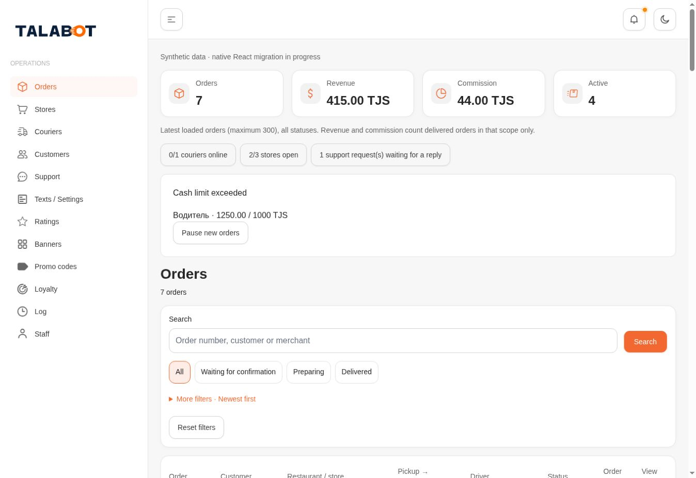
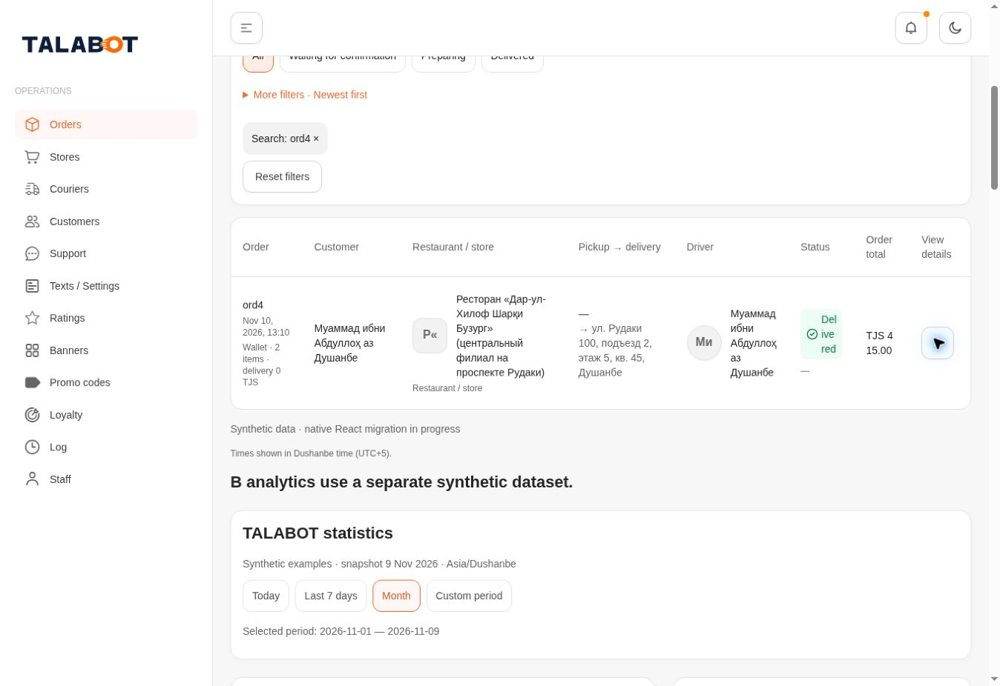
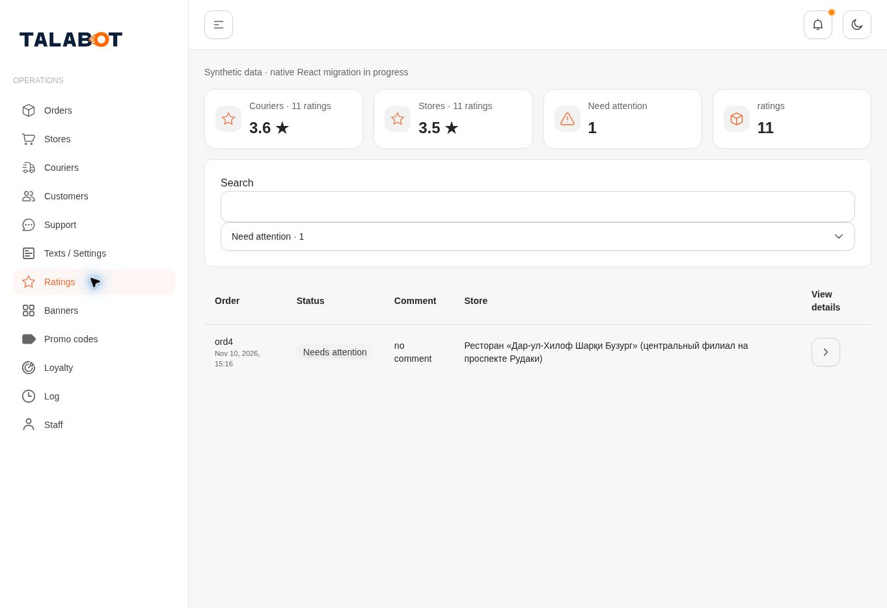
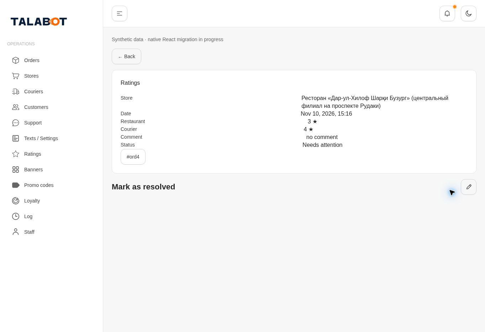
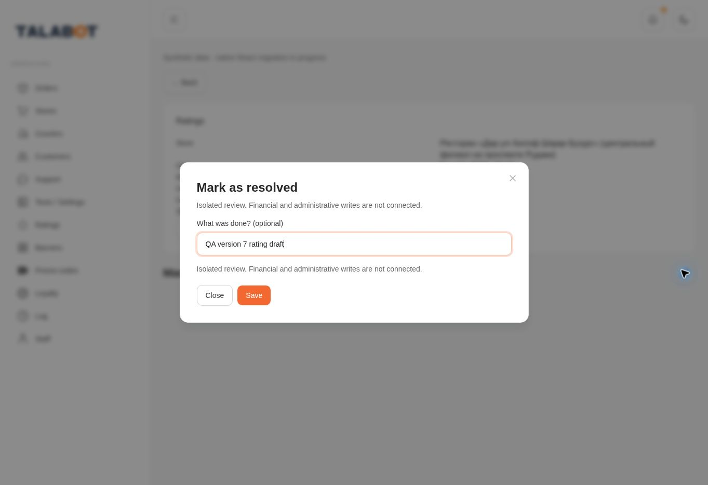
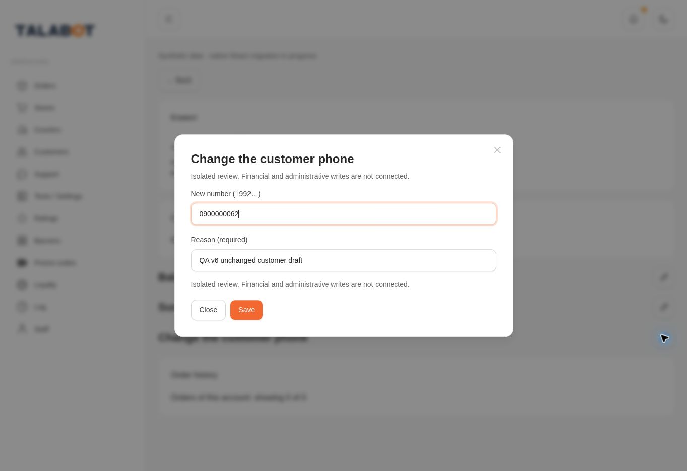

# Published v8 screenshots

All screenshots below are from source `604b4df7a947b5bff9664b9c6b99d13110b4f77e`, public version8. Actual viewport **1363×936**, not320/390/1440. JPEG capture area can exclude scrollbar (1348px); DOM geometry in browser-published.json is authoritative. No zoom/CSS substitute. No owner visual acceptance.

Requested320×844,390×844,1440×1000: **NOT TESTED / BLOCKED_CAPABILITY**; see responsive-capability.json.

## Home / orders loaded

## Order search

## Order detail

## Ratings list / follow-up

## Rating details

## Rating resolution dialog

## Customer edit dialog

