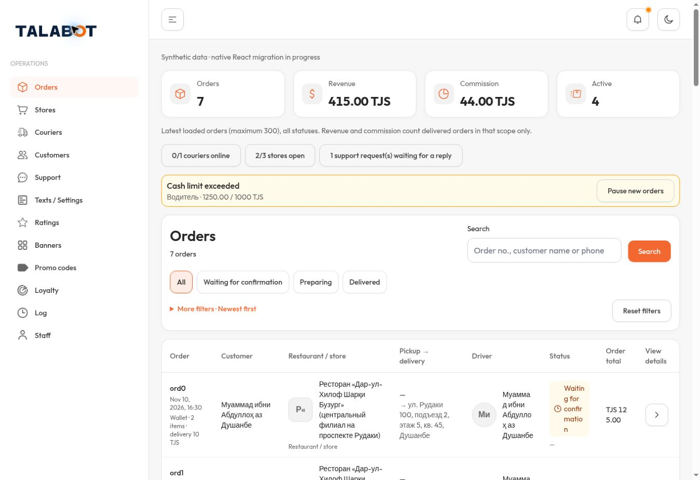
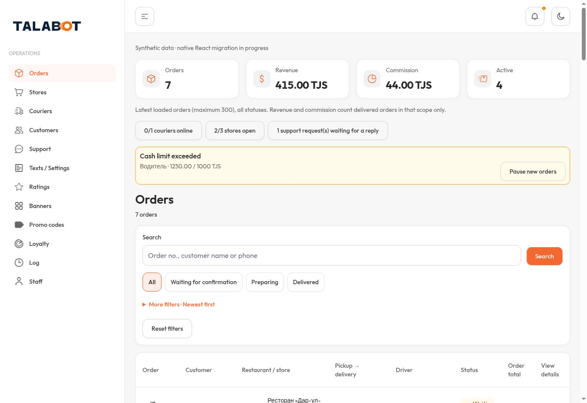
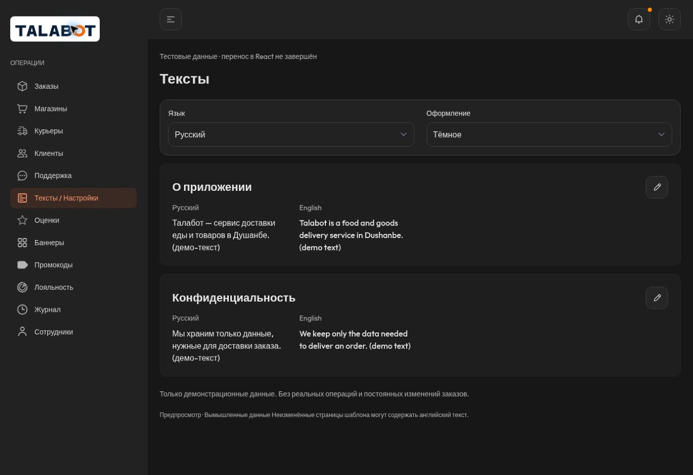
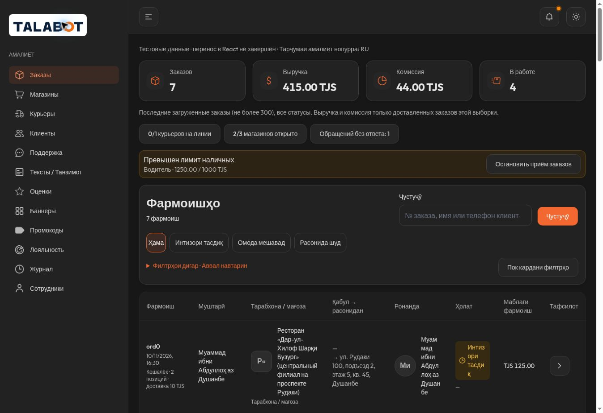
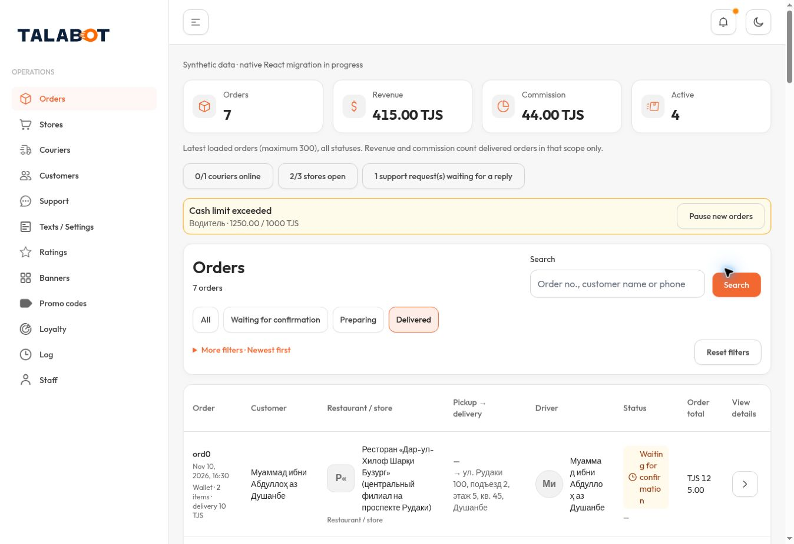

# Actual browser evidence —1363×936 only

No screenshot below is evidence for320/390/1440 or Safari. Viewport comes from DOM measurement; JPEG dimensions may differ because of browser capture behavior.

## Published v11 — EN Light

## Before — v10 / EN Light

## Final source — RU Dark

## Final source — TG Dark

## Expanded secondary filters

This capture preceded the final table cell padding correction. Filter composition did not change afterward; it is not the published final table-density proof.

Prior entity/edit screenshots and provenance are retained in [recovered v10 gallery](../audit-corrections/gallery.md); they are historical, not fresh captures.
